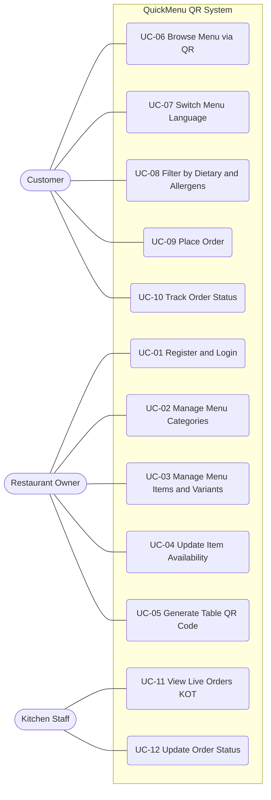

# Software Requirements Specification (SRS)
## QuickMenu QR – Dynamic Multi-Language Restaurant Menu & Ordering

| Field | Detail |
|---|---|
| **Document Standard** | IEEE Std 830-1998 (Recommended Practice for SRS) |
| **Project No.** | #031 |
| **Course** | Project 1 (Lab) – Department of Software Engineering Technology |
| **University** | Punjab Tianjin University of Technology |
| **Faculty Advisor** | Dr. Zaigham Mushtaq |
| **Prepared by** | Muhammad Haroon |
| **Version** | 1.0 (Week 2 Submission) |
| **Status** | Draft for Review |

---

## Revision History

| Version | Date | Author | Description |
|---|---|---|---|
| 0.1 | Week 1 | M. Haroon | Problem statement, personas, MVP features |
| 1.0 | Week 2 | M. Haroon | Full SRS, use cases, non-functional requirements |

---

## Table of Contents
1. Introduction
2. Overall Description
3. Specific Requirements
   - 3.1 External Interface Requirements
   - 3.2 Functional Requirements
   - 3.3 Use Case Specifications
   - 3.4 Non-Functional Requirements
   - 3.5 Database Requirements
   - 3.6 Design Constraints
4. System Use Case Diagram
5. Requirements Traceability Matrix
6. Appendices

---

# 1. Introduction

## 1.1 Purpose
This document specifies the software requirements for **QuickMenu QR**, a web-based digital menu and ordering system for cafes and restaurants. It is intended for the project team, the faculty advisor, and future developers and testers, and serves as the baseline for design (Week 3 onward), implementation, and testing.

## 1.2 Scope
QuickMenu QR allows restaurants to publish and manage a digital menu that customers access by scanning a QR code at their table. The system will:

- Let restaurant owners create and manage menu categories, items, prices, variants, photos, allergen tags, and stock availability.
- Generate printable QR codes for tables.
- Let customers browse the menu on their phones with no app installation, switch languages, and filter by dietary needs and allergens.
- Let customers place orders directly from their phones.
- Display incoming orders in real time on a Kitchen Order Ticket (KOT) screen.

**Out of scope (for this project version):** online payment processing, delivery management, inventory and supplier management, loyalty programs, and native mobile applications.

**Benefits:** Eliminates menu reprinting costs, reduces order errors, removes language barriers, and speeds up service.

## 1.3 Definitions, Acronyms, and Abbreviations

| Term | Definition |
|---|---|
| SRS | Software Requirements Specification |
| QR | Quick Response code |
| PWA | Progressive Web App, a web app that behaves like a mobile app |
| KOT | Kitchen Order Ticket, the order display used by kitchen staff |
| MVP | Minimum Viable Product |
| FR / NFR | Functional / Non-Functional Requirement |
| UC | Use Case |
| JWT | JSON Web Token (authentication) |
| TLS | Transport Layer Security |
| WebSocket | Protocol for real-time two-way communication |
| SMB | Small and Medium Business |
| p95 | 95th percentile of measured response times |

## 1.4 References
1. IEEE Std 830-1998, *IEEE Recommended Practice for Software Requirements Specifications*.
2. QuickMenu QR Project Sheet #031, Project 1 (Lab), PTUT.
3. QuickMenu QR Week 1 Report: Problem Statement, User Personas, MVP Features.
4. OWASP Top 10, Web Application Security Risks.
5. W3C WCAG 2.1, Web Content Accessibility Guidelines.

## 1.5 Overview
Section 2 describes the product context, users, and constraints. Section 3 lists detailed functional and non-functional requirements and the use case specifications. Section 4 presents the system use case diagram, and Section 5 maps requirements to MVP features.

---

# 2. Overall Description

## 2.1 Product Perspective
QuickMenu QR is a new, self-contained, multi-tenant web system, so each restaurant has its own isolated menu and order data. It has three client-facing parts and one backend:

| Component | Description | Technology |
|---|---|---|
| Owner Dashboard | Web interface to manage menu, QR codes, and settings | Next.js |
| Customer Menu | Mobile-first PWA opened through QR scan | Next.js (PWA) |
| Kitchen Display (KOT) | Live order screen for kitchen staff | Next.js + WebSockets |
| Backend API | Business logic, authentication, real-time events | Node.js |
| Database | Persistent data storage | PostgreSQL |
| Media Storage | Hosting and optimizing food images | Cloudinary |
| Translation Service | Translates menu text to the selected language | External translation API |

**High-level flow:** Owner builds menu → system generates table QR → customer scans, browses, and orders → backend stores the order and pushes it through WebSocket → KOT screen shows the order instantly.

## 2.2 Product Functions (Summary)
1. Owner authentication and restaurant profile management
2. Menu management (categories, items, variants, prices, photos, allergens)
3. Item availability (in stock / out of stock) control
4. Table QR code generation
5. Customer menu browsing via QR with no login
6. Multi-language menu translation
7. Dietary and allergen filtering
8. Cart and order placement
9. Real-time kitchen order display and status updates
10. Customer order status tracking

## 2.3 User Classes and Characteristics

| User Class | Description | Technical Skill | Frequency |
|---|---|---|---|
| **Restaurant Owner / Admin** | Manages menu, prices, QR codes, and staff view | Low to medium | Daily |
| **Customer (Diner)** | Scans QR, browses, orders from own phone; may be a tourist or student | Medium to high, but uses no app | Per visit |
| **Kitchen Staff** | Views and updates incoming orders on KOT screen | Low | Continuous during service |

## 2.4 Operating Environment
- **Client devices:** Smartphones with modern browsers (Chrome 100+, Safari 15+, Firefox 100+, Samsung Internet), plus a tablet or monitor for the KOT screen.
- **Server:** Linux-based cloud hosting running Node.js (LTS) and PostgreSQL 14+.
- **Network:** Customer 3G/4G/Wi-Fi; restaurant Wi-Fi for the KOT screen.

## 2.5 Design and Implementation Constraints
- Technology stack is fixed: Next.js, Node.js, PostgreSQL, Cloudinary, WebSockets.
- Must be a mobile-first web app, with no native app and no installation required.
- Must complete within the 4-month semester roadmap, ending with a pilot at 5 campus cafes or restaurants.
- Must use free or low-cost service tiers (student project budget).

## 2.6 Assumptions and Dependencies
- Customers have a smartphone with a camera or QR scanner and an internet connection.
- Restaurants provide a stable Wi-Fi connection for the KOT display.
- Cloudinary and the translation API remain available and within free-tier limits.
- Restaurants will enter menu text in a single base language (English or Urdu), and the system translates it.
- Payment is handled at the counter or table in this version (out of scope).

---

# 3. Specific Requirements

## 3.1 External Interface Requirements

### 3.1.1 User Interfaces
- **UI-1:** The customer interface shall be mobile-first, responsive from 320 px to 1280 px width.
- **UI-2:** The customer menu shall display item photo, name, description, price, and allergen icons.
- **UI-3:** The owner dashboard shall provide forms and tables for menu CRUD operations.
- **UI-4:** The KOT screen shall show order cards sorted by time, with large readable text and color-coded status.
- **UI-5:** The language selector shall be visible on every customer screen.

### 3.1.2 Hardware Interfaces
- No special hardware required. Customer devices use their camera for QR scanning. The restaurant uses any tablet, monitor, or PC browser for the KOT screen.

### 3.1.3 Software Interfaces

| Interface | Purpose | Protocol |
|---|---|---|
| PostgreSQL | Data persistence | SQL over TCP |
| Cloudinary API | Upload, store, and optimize images | HTTPS / REST |
| Translation API | Translate menu content | HTTPS / REST |
| WebSocket server | Real-time order push to KOT and status push to customer | WSS |

### 3.1.4 Communication Interfaces
- All client-server communication shall use HTTPS (TLS 1.2 or higher).
- Real-time updates shall use secure WebSockets (WSS).
- Data exchange format: JSON.

---

## 3.2 Functional Requirements

Priority: **H** = High (MVP), **M** = Medium, **L** = Low.

### 3.2.1 Authentication and Account Management

| ID | Requirement | Priority |
|---|---|---|
| FR-01 | The system shall allow a restaurant owner to register an account with name, email, password, and restaurant name. | H |
| FR-02 | The system shall authenticate owners using email and password and issue a session token (JWT). | H |
| FR-03 | The system shall allow owners to log out and shall expire sessions after inactivity. | H |
| FR-04 | The system shall allow owners to reset a forgotten password via email. | M |
| FR-05 | The system shall restrict dashboard and KOT access to authenticated users only. | H |

### 3.2.2 Menu Management (Owner)

| ID | Requirement | Priority |
|---|---|---|
| FR-06 | The system shall allow the owner to create, edit, reorder, and delete menu categories. | H |
| FR-07 | The system shall allow the owner to create, edit, and delete menu items with name, description, price, and category. | H |
| FR-08 | The system shall allow the owner to define item variants (e.g., size, add-ons) with individual prices. | H |
| FR-09 | The system shall allow the owner to upload up to 3 photos per item, stored via Cloudinary. | H |
| FR-10 | The system shall allow the owner to tag items with dietary labels (vegetarian, vegan, halal, gluten-free) and allergens (nuts, dairy, gluten, eggs, seafood, soy). | H |
| FR-11 | The system shall allow the owner to mark an item as available or out of stock, and out-of-stock items shall be hidden or visibly disabled to customers. | H |
| FR-12 | The system shall allow the owner to update prices, with changes reflected on customer menus immediately. | H |
| FR-13 | The system shall warn the owner before deleting a category that contains items. | M |

### 3.2.3 QR Code Management

| ID | Requirement | Priority |
|---|---|---|
| FR-14 | The system shall let the owner create tables (name or number) for the restaurant. | H |
| FR-15 | The system shall generate a unique QR code per table that links to the restaurant's customer menu with a table identifier. | H |
| FR-16 | The system shall allow the owner to download QR codes as PNG or PDF for printing. | H |

### 3.2.4 Customer Menu Browsing

| ID | Requirement | Priority |
|---|---|---|
| FR-17 | The system shall open the restaurant menu when a customer scans a table QR code, without requiring login or app installation. | H |
| FR-18 | The system shall display menu items grouped by category with photos, descriptions, prices, and variants. | H |
| FR-19 | The system shall allow the customer to search items by name. | M |
| FR-20 | The system shall allow the customer to select a display language, and the menu content shall be translated accordingly. | H |
| FR-21 | The system shall remember the customer's selected language for the session. | M |
| FR-22 | The system shall allow customers to filter items by dietary labels and to exclude items containing selected allergens. | H |

### 3.2.5 Ordering

| ID | Requirement | Priority |
|---|---|---|
| FR-23 | The system shall allow the customer to add items (with chosen variant and quantity) to a cart. | H |
| FR-24 | The system shall allow the customer to edit quantities, remove items, and add special instructions per order. | H |
| FR-25 | The system shall display the cart total before the order is submitted. | H |
| FR-26 | The system shall allow the customer to submit the order, associating it with the table identifier. | H |
| FR-27 | The system shall validate at submission that all ordered items are still available, and shall notify the customer if any item became unavailable. | H |
| FR-28 | The system shall show the customer an order confirmation with an order number. | H |
| FR-29 | The system shall let the customer view the live status of the order (Received, Preparing, Ready, Served). | M |

### 3.2.6 Kitchen Order Ticket (KOT)

| ID | Requirement | Priority |
|---|---|---|
| FR-30 | The system shall push each new order to the KOT screen in real time via WebSocket without page refresh. | H |
| FR-31 | The KOT screen shall show table, items, variants, quantities, special instructions, and order time. | H |
| FR-32 | The system shall play an audible or visual alert on the KOT screen when a new order arrives. | M |
| FR-33 | Kitchen staff shall be able to update order status (New, Preparing, Ready, Served, Cancelled). | H |
| FR-34 | The system shall automatically reconnect the KOT screen if the connection drops and shall load any missed orders. | H |

### 3.2.7 Reporting (Optional)

| ID | Requirement | Priority |
|---|---|---|
| FR-35 | The system shall let the owner view the order history filtered by date. | L |

---

## 3.3 Use Case Specifications

### 3.3.1 Actors

| Actor | Type | Description |
|---|---|---|
| Customer | Primary | Diner who scans the QR, browses, and orders |
| Restaurant Owner | Primary | Manages menu, tables, and QR codes |
| Kitchen Staff | Primary | Views and processes orders on KOT |
| Translation Service | Secondary (external) | Provides translation of menu text |
| Cloudinary | Secondary (external) | Stores and serves images |

### 3.3.2 Use Case List

| ID | Use Case | Primary Actor |
|---|---|---|
| UC-01 | Register and Login | Restaurant Owner |
| UC-02 | Manage Menu Categories | Restaurant Owner |
| UC-03 | Manage Menu Items and Variants | Restaurant Owner |
| UC-04 | Update Item Availability | Restaurant Owner |
| UC-05 | Generate Table QR Code | Restaurant Owner |
| UC-06 | Browse Menu via QR | Customer |
| UC-07 | Switch Menu Language | Customer |
| UC-08 | Filter by Dietary and Allergens | Customer |
| UC-09 | Place Order | Customer |
| UC-10 | Track Order Status | Customer |
| UC-11 | View Live Orders (KOT) | Kitchen Staff |
| UC-12 | Update Order Status | Kitchen Staff |

---

### UC-01: Register and Login

| Field | Description |
|---|---|
| **Use Case ID** | UC-01 |
| **Actor** | Restaurant Owner |
| **Description** | Owner creates an account and logs in to access the dashboard. |
| **Preconditions** | Owner has a valid email address and internet access. |
| **Postconditions** | Owner is authenticated and sees the dashboard. |
| **Trigger** | Owner opens the login or registration page. |

**Main Flow**
1. Owner selects "Register" and enters name, email, password, and restaurant name.
2. System validates the inputs (email format, password strength).
3. System creates the account and stores the password as a hash.
4. Owner enters email and password on the login page.
5. System verifies credentials and issues a session token.
6. System redirects the owner to the dashboard.

**Alternative Flows**
- 2a. Email already registered: system shows "Account already exists".
- 5a. Wrong credentials: system shows a generic error and increments the failed-attempt counter.

**Exceptions**
- E1. After 5 consecutive failed attempts, the system locks the account for 15 minutes.

**Related Requirements:** FR-01, FR-02, FR-03, FR-05

---

### UC-02: Manage Menu Categories

| Field | Description |
|---|---|
| **Use Case ID** | UC-02 |
| **Actor** | Restaurant Owner |
| **Description** | Owner creates, edits, reorders, and deletes categories (e.g., Starters, Drinks). |
| **Preconditions** | Owner is logged in. |
| **Postconditions** | Category changes are saved and visible on the customer menu. |

**Main Flow**
1. Owner opens "Menu" and selects "Categories".
2. Owner clicks "Add Category" and enters a name.
3. System validates (non-empty, unique per restaurant) and saves it.
4. Owner drags categories to set display order.
5. System saves the new order.

**Alternative Flows**
- 3a. Duplicate name: system rejects with a message.
- 6a. Owner deletes a category that contains items: system warns and asks for confirmation.

**Related Requirements:** FR-06, FR-13

---

### UC-03: Manage Menu Items and Variants

| Field | Description |
|---|---|
| **Use Case ID** | UC-03 |
| **Actor** | Restaurant Owner (secondary: Cloudinary) |
| **Description** | Owner adds or edits menu items with price, photos, variants, and dietary and allergen tags. |
| **Preconditions** | Owner is logged in; at least one category exists. |
| **Postconditions** | Item is saved and appears on the customer menu. |

**Main Flow**
1. Owner selects a category and clicks "Add Item".
2. Owner enters name, description, base price.
3. Owner uploads photos; system sends them to Cloudinary and stores the returned URLs.
4. Owner adds variants (e.g., Small / Large) with prices.
5. Owner selects dietary labels and allergen tags.
6. Owner clicks "Save".
7. System validates the data and saves the item.

**Alternative Flows**
- 2a. Price is negative or non-numeric: system shows a validation error.
- 3a. Image exceeds 5 MB or has an unsupported format: system rejects the image.
- 3b. Cloudinary is unreachable: system allows saving without an image and flags the item for retry.

**Related Requirements:** FR-07, FR-08, FR-09, FR-10, FR-12

---

### UC-04: Update Item Availability

| Field | Description |
|---|---|
| **Use Case ID** | UC-04 |
| **Actor** | Restaurant Owner |
| **Description** | Owner marks an item as in stock or out of stock. |
| **Preconditions** | Owner is logged in; the item exists. |
| **Postconditions** | Customer menus reflect the new availability within 2 seconds. |

**Main Flow**
1. Owner opens the item list.
2. Owner toggles the "Available" switch for an item.
3. System updates the item and refreshes active customer menus.

**Alternative Flows**
- 3a. Item is in an active cart: system blocks that item at order submission (see UC-09).

**Related Requirements:** FR-11, FR-27

---

### UC-05: Generate Table QR Code

| Field | Description |
|---|---|
| **Use Case ID** | UC-05 |
| **Actor** | Restaurant Owner |
| **Description** | Owner creates tables and downloads printable QR codes. |
| **Preconditions** | Owner is logged in. |
| **Postconditions** | Unique QR code per table is available for download. |

**Main Flow**
1. Owner opens "Tables" and clicks "Add Table".
2. Owner enters a table name or number.
3. System generates a unique QR code encoding the menu URL and table ID.
4. Owner selects "Download" and chooses PNG or PDF.
5. System provides the file.

**Alternative Flows**
- 2a. Duplicate table number: system rejects it.

**Related Requirements:** FR-14, FR-15, FR-16

---

### UC-06: Browse Menu via QR

| Field | Description |
|---|---|
| **Use Case ID** | UC-06 |
| **Actor** | Customer |
| **Description** | Customer scans a table QR code and views the menu on their phone. |
| **Preconditions** | Customer has a smartphone and internet; restaurant menu is published. |
| **Postconditions** | Menu is displayed with the table recognised. |

**Main Flow**
1. Customer scans the QR code at the table.
2. Phone opens the menu URL in the browser.
3. System identifies the restaurant and table.
4. System loads the menu grouped by category with photos and prices.
5. Customer scrolls and views item details and variants.

**Alternative Flows**
- 3a. Invalid or expired QR code: system shows "Invalid table" with guidance to ask staff.
- 4a. Slow network: system shows text first and lazy-loads images.

**Related Requirements:** FR-17, FR-18, FR-19

---

### UC-07: Switch Menu Language

| Field | Description |
|---|---|
| **Use Case ID** | UC-07 |
| **Actor** | Customer (secondary: Translation Service) |
| **Description** | Customer changes the menu language. |
| **Preconditions** | Menu is displayed (UC-06). |
| **Postconditions** | Menu text appears in the chosen language. |

**Main Flow**
1. Customer taps the language selector.
2. Customer chooses a language.
3. System requests translations (or loads cached translations).
4. System displays the translated menu and stores the choice for the session.

**Alternative Flows**
- 3a. Translation service unavailable: system shows the original language with a notice.

**Related Requirements:** FR-20, FR-21

---

### UC-08: Filter by Dietary and Allergens

| Field | Description |
|---|---|
| **Use Case ID** | UC-08 |
| **Actor** | Customer |
| **Description** | Customer filters items by dietary preference and excludes allergens. |
| **Preconditions** | Menu is displayed. |
| **Postconditions** | Only matching items are shown. |

**Main Flow**
1. Customer opens "Filters".
2. Customer selects dietary labels and/or allergens to avoid.
3. System filters the menu immediately.
4. Customer clears or changes filters as needed.

**Alternative Flows**
- 3a. No items match: system shows "No items match your filters" with a clear-filters option.

**Related Requirements:** FR-22

---

### UC-09: Place Order

| Field | Description |
|---|---|
| **Use Case ID** | UC-09 |
| **Actor** | Customer |
| **Description** | Customer builds a cart and submits the order to the kitchen. |
| **Preconditions** | Menu is displayed; table is identified. |
| **Postconditions** | Order is saved and sent to the KOT screen; customer receives an order number. |

**Main Flow**
1. Customer selects an item, variant, and quantity and taps "Add to Cart".
2. Customer repeats for other items.
3. Customer opens the cart, reviews items and total, and adds optional special instructions.
4. Customer taps "Place Order".
5. System re-validates availability and prices.
6. System saves the order with status "New" and table ID.
7. System pushes the order to the KOT screen in real time.
8. System displays a confirmation with the order number.

**Alternative Flows**
- 5a. An item became unavailable: system informs the customer, removes it, and asks them to confirm again.
- 4a. Cart is empty: "Place Order" is disabled.

**Exceptions**
- E1. Network failure during submission: system retries automatically and informs the customer if it fails, without creating duplicate orders.

**Related Requirements:** FR-23 to FR-28, FR-30

---

### UC-10: Track Order Status

| Field | Description |
|---|---|
| **Use Case ID** | UC-10 |
| **Actor** | Customer |
| **Description** | Customer views live progress of their order. |
| **Preconditions** | Order has been placed (UC-09). |
| **Postconditions** | Customer sees the current status. |

**Main Flow**
1. Customer opens the order status page.
2. System shows the current status (Received, Preparing, Ready, Served).
3. System updates the display automatically when the kitchen changes status.

**Related Requirements:** FR-29

---

### UC-11: View Live Orders (KOT)

| Field | Description |
|---|---|
| **Use Case ID** | UC-11 |
| **Actor** | Kitchen Staff |
| **Description** | Kitchen staff monitor incoming orders on the KOT screen. |
| **Preconditions** | Staff logged in on the KOT screen; WebSocket connected. |
| **Postconditions** | All active orders are visible. |

**Main Flow**
1. Staff opens the KOT screen.
2. System loads all active orders.
3. When a customer places an order, the system pushes it to the screen with an alert.
4. Staff reads the table, items, variants, and instructions.

**Alternative Flows**
- 3a. Connection drops: system shows an offline banner, reconnects automatically, and loads missed orders.

**Related Requirements:** FR-30 to FR-32, FR-34

---

### UC-12: Update Order Status

| Field | Description |
|---|---|
| **Use Case ID** | UC-12 |
| **Actor** | Kitchen Staff |
| **Description** | Kitchen staff change an order's status as it progresses. |
| **Preconditions** | An order exists on the KOT screen. |
| **Postconditions** | Status is saved and visible to the customer. |

**Main Flow**
1. Staff selects an order.
2. Staff changes status to Preparing, Ready, Served, or Cancelled.
3. System saves the status and pushes the update to the customer view.

**Alternative Flows**
- 2a. Cancel selected: system asks for confirmation and notifies the customer.

**Related Requirements:** FR-33, FR-29

---

## 3.4 Non-Functional Requirements (Quantifiable)

### 3.4.1 Performance

| ID | Requirement | Measurement Method |
|---|---|---|
| NFR-P1 | The customer menu shall reach Largest Contentful Paint in **≤ 2.5 s** and be fully interactive in **≤ 3 s** on a 4G connection (about 4 Mbps) for 95% of loads. | Google Lighthouse, WebPageTest |
| NFR-P2 | Backend API responses shall have **p95 ≤ 300 ms** and **p99 ≤ 800 ms** under normal load. | Load test (k6 / Artillery) |
| NFR-P3 | A new order shall appear on the KOT screen within **≤ 2 seconds** of submission for 95% of orders. | Timestamp comparison in testing |
| NFR-P4 | Language switching shall complete in **≤ 1.5 s** (cached) and **≤ 3 s** (uncached). | Manual and automated timing |
| NFR-P5 | Each product image served to customers shall be **≤ 200 KB** after Cloudinary optimization. | Network inspection |
| NFR-P6 | The system shall support **at least 500 concurrent customer sessions** and **at least 25 concurrent KOT/WebSocket connections** with no more than 1% error rate. | Load test |

### 3.4.2 Security

| ID | Requirement | Measurement Method |
|---|---|---|
| NFR-S1 | All traffic shall use **HTTPS with TLS 1.2 or higher**; HTTP shall redirect to HTTPS. | SSL Labs scan (grade A or above) |
| NFR-S2 | Passwords shall be hashed with **bcrypt (cost factor ≥ 10)**; plaintext passwords shall never be stored or logged. | Code review |
| NFR-S3 | Owner sessions shall use JWTs that **expire after 60 minutes** of inactivity (refresh token ≤ 7 days). | Functional test |
| NFR-S4 | The system shall **lock an account for 15 minutes after 5 failed logins**. | Functional test |
| NFR-S5 | All database queries shall use **parameterized statements**, with zero known SQL-injection or XSS vulnerabilities. | OWASP ZAP scan |
| NFR-S6 | Each restaurant's data shall be isolated: **0 cross-tenant data leaks** in access-control tests. | Authorization test cases |
| NFR-S7 | Customer ordering shall **not collect personal data** (no name, phone, or email required), reducing privacy exposure. | Design review |
| NFR-S8 | API endpoints shall be **rate limited to 100 requests per minute per IP**. | Load test |

### 3.4.3 Reliability and Availability

| ID | Requirement | Measurement Method |
|---|---|---|
| NFR-R1 | System uptime shall be **≥ 99.5% per month** (about 3.6 hours maximum downtime) during pilot operation. | Uptime monitor (e.g., UptimeRobot) |
| NFR-R2 | Database backups shall run **daily**, with a **Recovery Point Objective (RPO) ≤ 24 hours** and **Recovery Time Objective (RTO) ≤ 4 hours**. | Restore test |
| NFR-R3 | The KOT WebSocket shall **auto-reconnect within 10 seconds** of connection loss and recover missed orders. | Network-interruption test |
| NFR-R4 | **No order shall be lost**: 100% of confirmed orders must be persisted before confirmation is shown. | Integration test |
| NFR-R5 | Duplicate submissions of the same order shall be prevented (idempotency), with **0 duplicate orders** in test runs. | Test cases |

### 3.4.4 Usability and Accessibility

| ID | Requirement | Measurement Method |
|---|---|---|
| NFR-U1 | A first-time customer shall be able to place an order in **≤ 3 minutes** and **≤ 6 taps** after the menu loads, without instructions. | Usability test with at least 5 users |
| NFR-U2 | The owner shall be able to add a new menu item in **≤ 2 minutes**. | Usability test |
| NFR-U3 | The customer UI shall meet **WCAG 2.1 Level AA** contrast and text-size guidelines. | Lighthouse accessibility score ≥ 90 |
| NFR-U4 | The system shall support **at least 5 languages** at launch (English, Urdu, Arabic, Chinese, French). | Functional test |
| NFR-U5 | Touch targets shall be **at least 44 × 44 px**. | UI review |
| NFR-U6 | The System Usability Scale (SUS) score from pilot users shall be **≥ 70**. | Pilot survey |

### 3.4.5 Compatibility and Portability

| ID | Requirement | Measurement Method |
|---|---|---|
| NFR-C1 | The customer app shall work on **Chrome, Safari, Firefox, and Samsung Internet (latest 2 major versions)** on Android 9+ and iOS 14+. | Cross-browser test |
| NFR-C2 | The PWA shall score **≥ 90 in Lighthouse PWA/Performance** categories. | Lighthouse |
| NFR-C3 | The layout shall be usable from **320 px to 1280 px** width. | Responsive test |

### 3.4.6 Maintainability and Scalability

| ID | Requirement | Measurement Method |
|---|---|---|
| NFR-M1 | Automated unit test coverage shall be **≥ 70%** for backend business logic. | Coverage report |
| NFR-M2 | The system shall onboard a new restaurant in **≤ 15 minutes** with no code changes (multi-tenant design). | Pilot onboarding test |
| NFR-M3 | The architecture shall scale to **50 restaurants** by adding server resources only, with no redesign. | Design review |

---

## 3.5 Database Requirements (Logical)

Main entities (detailed ERD in Week 3):

| Entity | Key Attributes |
|---|---|
| Restaurant | id, name, owner_id, default_language, created_at |
| User | id, name, email, password_hash, role, restaurant_id |
| Category | id, restaurant_id, name, display_order |
| MenuItem | id, category_id, name, description, base_price, is_available, dietary_tags, allergens |
| ItemVariant | id, item_id, name, price |
| ItemImage | id, item_id, cloudinary_url |
| RestaurantTable | id, restaurant_id, table_number, qr_token |
| Order | id, restaurant_id, table_id, status, total, notes, created_at |
| OrderItem | id, order_id, item_id, variant_id, quantity, unit_price |
| Translation (cache) | id, entity_id, language, translated_text |

**Rules:** Prices are stored as exact decimals; order items store the unit price at order time so later price changes never alter past orders.

## 3.6 Design Constraints and Standards
- Follow REST API conventions and JSON data format.
- Follow OWASP secure-coding guidelines.
- Use Git version control with feature branches.
- Code shall follow a consistent linting standard (ESLint and Prettier).

---

# 4. System Use Case Diagram

See the attached image **`QuickMenuQR_UseCase_Diagram.png`**. A text version of the same diagram (Mermaid) is below for reference.

---

# 5. Requirements Traceability Matrix

| MVP Feature (Week 1) | Use Cases | Functional Reqs | Key NFRs |
|---|---|---|---|
| 1. Menu builder dashboard | UC-01 to UC-05 | FR-01 to FR-16 | NFR-S2, S3, U2 |
| 2. QR-based mobile menu | UC-06 | FR-17 to FR-19 | NFR-P1, C1, C2 |
| 3. Multi-language translation | UC-07 | FR-20, FR-21 | NFR-P4, U4 |
| 4. Dietary and allergen filters | UC-08 | FR-22 | NFR-U3 |
| 5. Order submission and live kitchen display | UC-09 to UC-12 | FR-23 to FR-34 | NFR-P3, R3, R4, R5 |

---

# 6. Appendices

## Appendix A: Risks and Mitigations

| Risk | Impact | Mitigation |
|---|---|---|
| Poor restaurant Wi-Fi breaks the KOT feed | High | Auto-reconnect, missed-order recovery (FR-34, NFR-R3) |
| Translation API cost or quota limits | Medium | Cache translations (NFR-P4) |
| Inaccurate allergen data entered by owner | High | Clear owner disclaimer; customer-facing note to confirm with staff |
| Low owner adoption | Medium | Simple UI (NFR-U2), pilot onboarding support |
| Free-tier service limits | Medium | Image optimization, caching |

## Appendix B: Open Issues
1. Final list of supported languages to be confirmed with pilot cafes.
2. Choice of translation provider (to be finalized in Week 3 design).
3. Whether customers should be able to re-order or add to an existing order after submission.

*End of Document*
