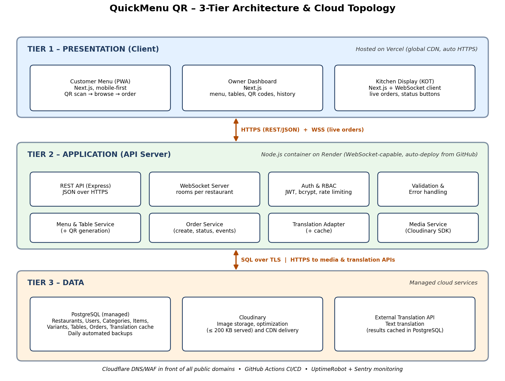
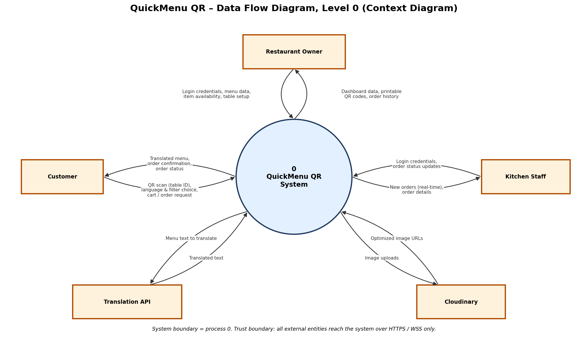
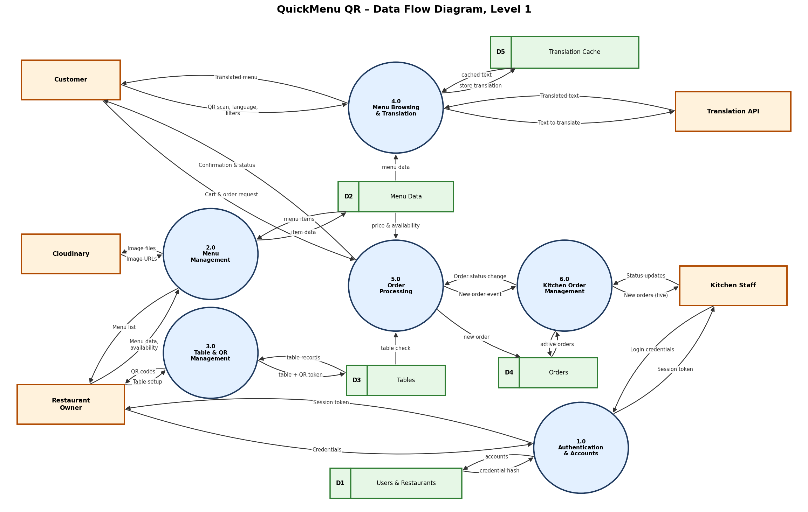

# High-Level Architecture & Cloud Topology
## QuickMenu QR – Dynamic Multi-Language Restaurant Menu & Ordering

| Field | Detail |
|---|---|
| **Project No.** | #031 |
| **Course** | Project 1 (Lab), Department of Software Engineering Technology |
| **University** | Punjab Tianjin University of Technology |
| **Faculty Advisor** | Dr. Zaigham Mushtaq |
| **Prepared by** | Muhammad Haroon |
| **Version** | 1.0 (Week 3 Submission) |
| **Input documents** | Week 1 Problem Statement and MVP features; Week 2 SRS (IEEE 830) v1.0 |

---

## 1. Introduction

### 1.1 Purpose
Week 2 defined **what** QuickMenu QR must do (the SRS). This document defines **how the system is structured** at a high level: its layers, its boundaries, how data moves through it, and where it runs in the cloud. It is the foundation for the detailed design (database schema, API contract, wireframes) in Week 4 onward.

### 1.2 Contents
1. Architectural drivers (the requirements that shape the design)
2. System boundaries and trust boundaries
3. 3-Tier Architecture (diagram and tier descriptions)
4. Data Flow Diagrams, Level 0 and Level 1
5. Real-time design (orders to the kitchen)
6. Cloud topology and infrastructure stack justification
7. Security architecture
8. Scalability, reliability, and monitoring
9. Environments and CI/CD
10. Architecture decisions, risks, and traceability

---

## 2. Architectural Drivers

The architecture is driven by these SRS requirements:

| Driver | SRS Reference | Architectural Consequence |
|---|---|---|
| Menu loads in ≤ 2.5 s (LCP) on 4G | NFR-P1 | Static assets on a global CDN, server-side rendering, optimized images |
| Order reaches kitchen in ≤ 2 s | NFR-P3 | Persistent WebSocket channel, not polling |
| 500 concurrent customers, 25 KOT connections | NFR-P6 | Stateless API server that can scale horizontally |
| 99.5% uptime, daily backups | NFR-R1, R2 | Managed database with automated backups, health checks, auto-restart |
| No lost orders | NFR-R4 | Order written to the database **before** confirmation and before the kitchen push |
| Secure by default | NFR-S1 to S8 | HTTPS everywhere, JWT, bcrypt, rate limiting, tenant isolation |
| No app installation, mobile-first | FR-17, NFR-C1 | Progressive Web App (PWA) in the browser |
| Multi-restaurant (multi-tenant) | NFR-M2, M3 | `restaurant_id` on every record; one deployment serves many restaurants |
| Low cost (student project) | SRS 2.5 | Managed free or low-cost tiers, no servers to administer |

---

## 3. System Boundaries

### 3.1 Inside the system boundary (we build and own)
- Next.js web application: customer menu (PWA), owner dashboard, kitchen display (KOT)
- Node.js API server: REST endpoints, WebSocket server, authentication, business logic
- PostgreSQL database schema and the data in it
- QR code generation logic
- Translation caching logic

### 3.2 Outside the system boundary (external actors and services)

| External Party | Type | Interaction |
|---|---|---|
| Customer | Human actor | Scans QR, browses, orders |
| Restaurant Owner | Human actor | Manages menu, tables, QR codes |
| Kitchen Staff | Human actor | Views and updates orders |
| Translation API | External service | Translates menu text on request |
| Cloudinary | External service | Stores, optimizes, and delivers images |
| Email service (optional) | External service | Password-reset emails |

### 3.3 Explicitly out of scope
Online payments, delivery management, inventory and supplier management, loyalty programs, native mobile apps, and POS integration.

### 3.4 Trust boundaries
1. **Internet to Edge:** all public traffic passes through Cloudflare (DNS and WAF) and Vercel over HTTPS. Customers are **untrusted and anonymous**.
2. **Edge to API server:** only HTTPS and WSS. The API validates every request. Owner and kitchen routes require a valid JWT.
3. **API server to Database:** the database accepts connections **only** from the API server over TLS. It is never exposed to browsers.
4. **API server to third parties:** outbound HTTPS with API keys stored as environment secrets, never in client code.

---

## 4. 3-Tier Architecture



*Figure 1: 3-Tier Architecture and Cloud Topology (file: QuickMenuQR_3Tier_Architecture.png)*

### 4.1 Tier 1: Presentation (Client)
**Role:** Everything the user sees and touches. Contains no business rules and no direct database access.

| Component | Users | Responsibilities |
|---|---|---|
| Customer Menu (PWA) | Customer | QR landing, menu browsing, language switch, filters, cart, order, status tracking |
| Owner Dashboard | Owner | Login, category and item management, availability toggle, table and QR management, order history |
| Kitchen Display (KOT) | Kitchen staff | Live order cards, alert, status buttons, auto-reconnect |

**Technology:** Next.js (React) with server-side rendering for fast first paint, PWA manifest and service worker for caching, and a WebSocket client for live updates.

### 4.2 Tier 2: Application (API Server)
**Role:** All business logic, validation, security, and real-time messaging.

| Component | Responsibility |
|---|---|
| REST API (Express) | CRUD endpoints for menu, tables, orders; JSON over HTTPS |
| WebSocket Server | Pushes new orders to kitchen screens and status changes to customers; one **room per restaurant** so data never leaks across restaurants |
| Auth & RBAC | Registration, login, JWT issue and verify, role checks (owner, kitchen), account lockout, rate limiting |
| Validation & Error Handling | Input validation on every request, consistent error responses |
| Menu & Table Service | Menu logic, table management, QR code generation |
| Order Service | Order creation (with availability and price re-check), status transitions, event emission |
| Translation Adapter | Calls the translation API, checks the cache first, writes results back |
| Media Service | Signed image uploads to Cloudinary, stores returned URLs |

**Technology:** Node.js (LTS) with Express and a WebSocket library (Socket.IO or ws). The server is **stateless**: no session data in memory, so more instances can be added behind a load balancer.

### 4.3 Tier 3: Data
**Role:** Durable storage.

| Component | Contents |
|---|---|
| PostgreSQL (managed) | Restaurants, users, categories, items, variants, tables, orders, order items, translation cache |
| Cloudinary | Food photos (originals and optimized variants), delivered over its CDN |

**Technology:** PostgreSQL 14+ with relational integrity (foreign keys, transactions) and daily automated backups.

### 4.4 Communication between tiers

| From to To | Protocol | Purpose |
|---|---|---|
| Browser to API | HTTPS, REST, JSON | Menu, orders, management operations |
| Browser to API | WSS (WebSocket Secure) | Live orders and status updates |
| API to PostgreSQL | SQL over TLS | Reads and writes |
| API to Cloudinary | HTTPS | Signed uploads |
| Browser to Cloudinary CDN | HTTPS | Image display |
| API to Translation API | HTTPS | Translation requests |

### 4.5 Why 3-tier?
- **Separation of concerns:** UI changes never touch business rules or the database.
- **Security:** the database is reachable only from the API tier.
- **Independent scaling:** the API tier scales separately from the static front end.
- **Team fit:** matches the course stack (Next.js, Node.js, PostgreSQL) and allows work in parallel.

---

## 5. Data Flow Diagrams

### 5.1 DFD Level 0 (Context Diagram)



*Figure 2: DFD Level 0 (file: QuickMenuQR_DFD_Level0.png)*

The whole system is one process (**0 – QuickMenu QR System**) interacting with five external entities.

| External Entity | Data In (to system) | Data Out (from system) |
|---|---|---|
| Customer | QR scan (table ID), language and filter choice, cart and order request | Translated menu, order confirmation, order status |
| Restaurant Owner | Login credentials, menu data, item availability, table setup | Dashboard data, printable QR codes, order history |
| Kitchen Staff | Login credentials, order status updates | New orders (real-time), order details |
| Translation API | Translated text | Menu text to translate |
| Cloudinary | Optimized image URLs | Image uploads |

### 5.2 DFD Level 1



*Figure 3: DFD Level 1 (file: QuickMenuQR_DFD_Level1.png)*

Process 0 is decomposed into six sub-processes and five data stores. Every external flow from Level 0 appears again at Level 1, so the diagrams are **balanced**.

#### Processes

| ID | Process | Description | Main Use Cases / FRs |
|---|---|---|---|
| 1.0 | Authentication & Accounts | Registers and authenticates owners and kitchen staff; issues session tokens | UC-01; FR-01 to FR-05 |
| 2.0 | Menu Management | Create, update, delete categories, items, variants, tags, availability; handles image upload | UC-02, 03, 04; FR-06 to FR-13 |
| 3.0 | Table & QR Management | Creates tables and generates QR codes | UC-05; FR-14 to FR-16 |
| 4.0 | Menu Browsing & Translation | Serves the menu for a table, applies language and filters, uses the translation cache | UC-06, 07, 08; FR-17 to FR-22 |
| 5.0 | Order Processing | Validates the table and item availability, saves the order, emits the new-order event, reports status to the customer | UC-09, 10; FR-23 to FR-29 |
| 6.0 | Kitchen Order Management | Delivers live orders to the kitchen and records status updates | UC-11, 12; FR-30 to FR-34 |

#### Data stores

| ID | Data Store | Contents |
|---|---|---|
| D1 | Users & Restaurants | Accounts, password hashes, roles, restaurant profile |
| D2 | Menu Data | Categories, items, variants, prices, tags, allergens, availability, image URLs |
| D3 | Tables | Table numbers and QR tokens |
| D4 | Orders | Orders, order items, status, timestamps |
| D5 | Translation Cache | Previously translated text by language |

#### Key data flows

| Flow | From to To | Content |
|---|---|---|
| Credentials | Owner / Kitchen to 1.0 | Email and password |
| Session token | 1.0 to Owner / Kitchen | Signed JWT |
| Menu data, availability | Owner to 2.0 | Item and category changes |
| Image files / Image URLs | 2.0 to Cloudinary / Cloudinary to 2.0 | Uploads and optimized links |
| Table setup / QR codes | Owner to 3.0 / 3.0 to Owner | Table names and QR images |
| QR scan, language, filters | Customer to 4.0 | Table token and preferences |
| Text to translate / Translated text | 4.0 to Translation API / back | Menu strings |
| Menu data | D2 to 4.0 | Items for the restaurant |
| Cart & order request | Customer to 5.0 | Items, variants, quantities, notes |
| Price & availability, table check | D2, D3 to 5.0 | Validation data |
| New order | 5.0 to D4 | Saved order |
| New order event | 5.0 to 6.0 | Real-time notification |
| New orders (live) | 6.0 to Kitchen | Order cards |
| Status updates | Kitchen to 6.0 | New status |
| Order status change | 6.0 to 5.0 | Status for the customer view |
| Confirmation & status | 5.0 to Customer | Order number and progress |

---

## 6. Real-Time Design (Orders to Kitchen)

This is the most time-critical path (NFR-P3: ≤ 2 s).

**Sequence:**
1. Customer submits the order over HTTPS.
2. API validates the table token, item availability, and prices.
3. API **writes the order to PostgreSQL inside a transaction** (nothing is confirmed before this succeeds, satisfying NFR-R4).
4. API emits `order:new` to the WebSocket room `restaurant:{id}`.
5. The KOT screen receives the event, plays an alert, and shows the card.
6. API returns the order number to the customer.
7. When staff change the status, the API saves it and emits `order:status` to the room `order:{id}`, which the customer's browser is subscribed to.

**Event contract (draft):**

| Event | Direction | Payload |
|---|---|---|
| `order:new` | Server to KOT | order id, table, items, variants, quantities, notes, time |
| `order:status` | Server to Customer and KOT | order id, new status, time |
| `order:update_status` | KOT to Server | order id, new status |
| `kot:sync` | Server to KOT (on reconnect) | all active orders, so missed orders are recovered |

**Resilience rules:**
- The KOT client reconnects automatically within 10 s (NFR-R3) and requests `kot:sync`.
- The database is the source of truth, and WebSocket messages are only notifications.
- Order submission is idempotent (client-generated request ID) to prevent duplicates (NFR-R5).
- If the WebSocket fails, the KOT falls back to polling every 5 s.

**Scale note:** with one API instance, WebSocket rooms live in memory. If a second instance is added, a Redis pub/sub adapter will relay events between instances. This is a planned upgrade, not an MVP need.

---

## 7. Cloud Topology and Infrastructure Stack

### 7.1 Deployment topology

```
                         Internet
                            |
                 Cloudflare (DNS, WAF, DDoS)
                            |
        +-------------------+--------------------+
        |                                        |
  Vercel (Tier 1)                         Render Web Service (Tier 2)
  Next.js: Customer PWA,                  Node.js API + WebSocket
  Owner Dashboard, KOT                    (HTTPS / WSS, auto-deploy)
  Global CDN, auto HTTPS                          |
                                   +--------------+---------------+
                                   |              |               |
                          Managed PostgreSQL   Cloudinary    Translation API
                          (Tier 3, TLS only,   (images + CDN) (HTTPS)
                           daily backups)
```

### 7.2 Chosen stack and justification

| Layer | Choice | Justification |
|---|---|---|
| **Frontend hosting** | **Vercel** | Built by the creators of Next.js, so zero-config SSR and PWA hosting. Global CDN gives fast first paint (NFR-P1). Automatic HTTPS and preview deployments per branch. Generous free tier for a student project. |
| **API and WebSocket hosting** | **Render** (Web Service) | Runs a long-lived Node.js process, which is **required for WebSockets**. Serverless platforms (including Vercel functions) do not keep persistent connections. Auto-deploy from GitHub, health checks, auto-restart, managed TLS. |
| **Database** | **Managed PostgreSQL** (Render Postgres, or Neon / Supabase as alternatives) | Required by the project stack. Managed service provides automated backups (NFR-R2), TLS, and no database administration. Relational model suits orders, items, and strict integrity. |
| **Media** | **Cloudinary** | Required by the project stack. On-the-fly resizing and compression to meet the ≤ 200 KB image target (NFR-P5), CDN delivery, offloads image traffic from our API. |
| **Edge / DNS / WAF** | **Cloudflare** (free plan) | DNS, DDoS protection, basic WAF rules and rate limiting as an additional layer in front of the apps (NFR-S1, S8). |
| **Translation** | External translation API (final provider chosen in Week 4) | Avoids building ML translation. Results are cached in PostgreSQL to cut cost and latency (NFR-P4). |
| **CI/CD** | **GitHub + GitHub Actions** | Runs lint and tests on every push, triggers automatic deploys. |
| **Monitoring** | **UptimeRobot + Sentry** | Uptime checks for the 99.5% target (NFR-R1) and error tracking in production. |

### 7.3 Why not the alternatives?

| Alternative | Reason not chosen (for now) |
|---|---|
| AWS (EC2, RDS, S3) or Azure/GCP | Very capable, but needs far more setup (networking, IAM, patching) and has less predictable cost. Too heavy for a 4-month student project. It remains the **migration path** if the product grows. |
| Fully serverless API (Vercel/Lambda functions) | Cannot hold persistent WebSocket connections, which are essential to the live kitchen display. |
| Single VPS running everything | Cheap, but we would own OS patching, backups, TLS, and scaling. Higher operational risk. |
| Firebase (Firestore) | Has real-time sync, but a NoSQL model fits orders and relational menu data poorly and conflicts with the required PostgreSQL stack. |
| Polling instead of WebSockets | Would break the ≤ 2 s kitchen latency or flood the server with requests. |

### 7.4 Region and latency
Deploy the API and database in the **same region** (minimizes query latency), choosing the available region closest to Pakistan (for example, a Singapore or Mumbai region where the provider offers one). Static content is served from the CDN edge regardless of region.

### 7.5 Cost approach
All selected services offer free or low-cost tiers suitable for development and the 5-restaurant pilot. Free-tier limits and pricing change over time, so **verify current limits before the Month 4 pilot**. Known free-tier trade-off: some hosts put idle services to sleep, which can delay the first request. For the pilot, use the lowest paid always-on tier for the API so the kitchen display is never disconnected.

---

## 8. Security Architecture

| Concern | Control |
|---|---|
| Transport | HTTPS and WSS only (TLS 1.2+), HTTP redirected, HSTS enabled |
| Authentication | Email and password, bcrypt (cost ≥ 10), JWT with 60-minute expiry, 5-attempt lockout |
| Authorization | Role checks (owner, kitchen); every query filtered by `restaurant_id` (no cross-tenant access) |
| Customer privacy | No personal data collected from customers; table token only |
| Input safety | Server-side validation, parameterized SQL, output escaping (SQL injection and XSS prevention) |
| Abuse protection | Rate limiting (100 requests per minute per IP), Cloudflare WAF, order throttling per table |
| QR token safety | QR contains a random unguessable token rather than a sequential ID |
| Secrets | API keys and database URL in environment variables on the host, never in the repository or client bundle |
| Database access | Reachable only by the API server, credentials rotated if leaked |
| Dependencies | `npm audit` in CI, lockfile committed |

---

## 9. Scalability, Reliability, and Monitoring

**Scalability**
- Tier 1 scales automatically via the CDN.
- Tier 2 is stateless, so scaling out means adding instances behind the host's load balancer (plus Redis pub/sub for WebSocket events).
- Tier 3 scales up (larger plan), with read replicas as a later option.
- Multi-tenant design: onboarding a new restaurant needs only data, not deployment (NFR-M2).

**Reliability**
- Daily database backups with restore test (RPO ≤ 24 h, RTO ≤ 4 h).
- Health-check endpoint (`/health`) monitored every 5 minutes.
- Graceful degradation: if translation fails, show the original language; if an image fails, show text only.
- Database transactions guarantee no partial orders.

**Monitoring**
- UptimeRobot for availability, Sentry for exceptions, structured server logs, and basic API latency metrics against the p95 ≤ 300 ms target.

---

## 10. Environments and CI/CD

| Environment | Purpose | Hosting |
|---|---|---|
| Local | Development | Developer laptop, local PostgreSQL |
| Staging | Integration testing, demos to advisor | Vercel preview + Render staging + separate database |
| Production | Pilot restaurants | Vercel + Render + production database |

**Pipeline:** push to a feature branch, then GitHub Actions runs lint and tests, then pull request review, then merge to `main`, then automatic deploy to staging, then manual promotion to production.

---

## 11. Architecture Decisions

| # | Decision | Rationale |
|---|---|---|
| AD-1 | 3-tier architecture | Separation of concerns, security, independent scaling |
| AD-2 | Next.js PWA instead of a native app | No installation, one codebase, instant access via QR |
| AD-3 | Node.js on a persistent server (not serverless) | WebSockets need long-lived connections |
| AD-4 | PostgreSQL as single source of truth | Strong integrity for orders and menus |
| AD-5 | Write order to DB before notifying kitchen | No lost orders |
| AD-6 | Cache translations in PostgreSQL | Lower cost and latency |
| AD-7 | Managed services over self-hosted servers | Less operational work and risk for a student team |
| AD-8 | One WebSocket room per restaurant | Tenant isolation and efficient broadcast |

## 12. Risks

| Risk | Impact | Mitigation |
|---|---|---|
| Free-tier services sleep or hit limits | KOT misses orders | Paid always-on API tier for pilot; polling fallback |
| Restaurant Wi-Fi drops | Delayed orders | Auto-reconnect, `kot:sync` recovery |
| Translation API cost or quota | Feature degrades | Caching, quota monitoring, fallback to original language |
| Single API instance failure | Downtime | Health checks, auto-restart, second instance before wider rollout |
| Vendor lock-in | Migration effort | Standard Node.js and PostgreSQL, so the stack is portable to AWS |

## 13. Traceability to Requirements

| Architecture Element | Satisfies |
|---|---|
| CDN-hosted SSR PWA | FR-17, NFR-P1, NFR-C1, NFR-C2 |
| Persistent WebSocket server | FR-30 to FR-34, NFR-P3, NFR-R3 |
| Stateless API tier | NFR-P6, NFR-M3 |
| PostgreSQL with transactions | NFR-R4, NFR-R5, FR-26 |
| JWT, bcrypt, rate limiting, WAF | NFR-S1 to S8 |
| Tenant-scoped data and rooms | NFR-S6, NFR-M2 |
| Cloudinary optimization | NFR-P5, FR-09 |
| Translation cache | FR-20, NFR-P4 |
| Backups, monitoring | NFR-R1, NFR-R2 |

---

*End of Document*
