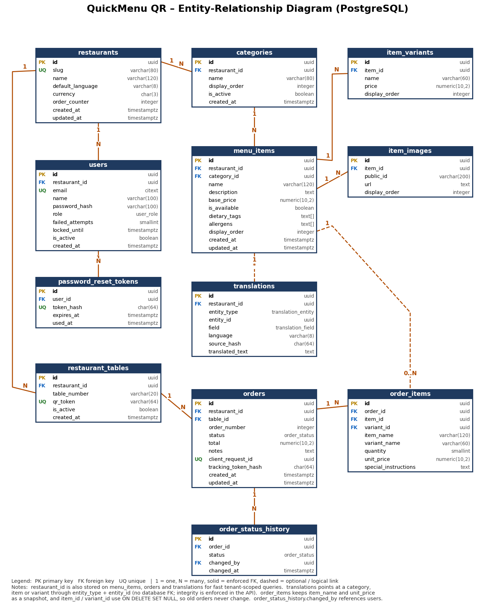
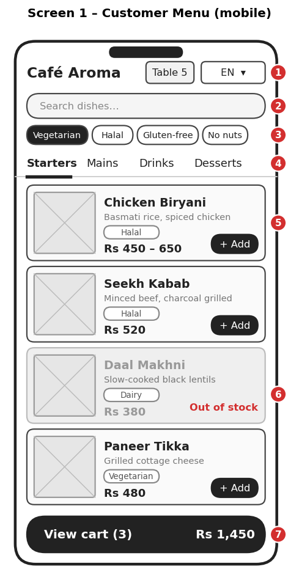
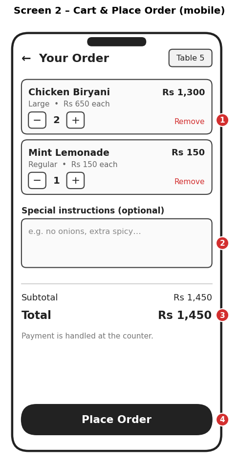
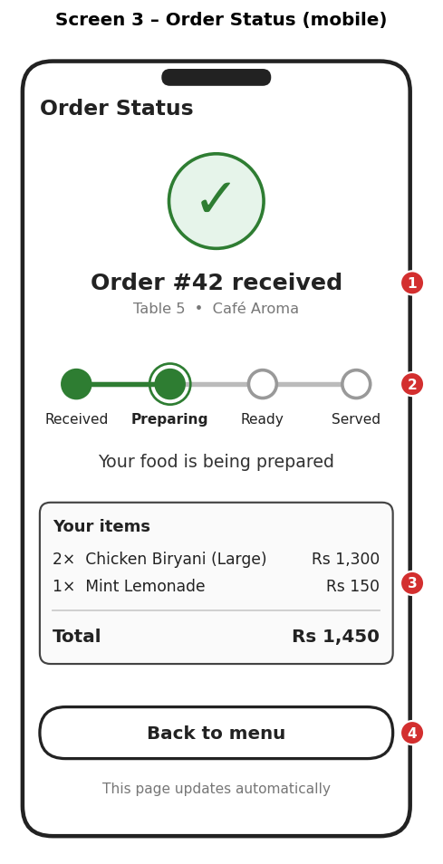
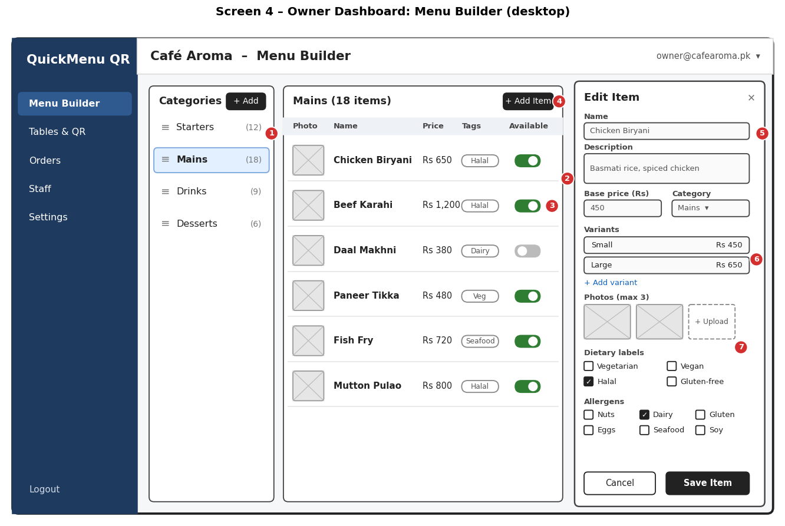
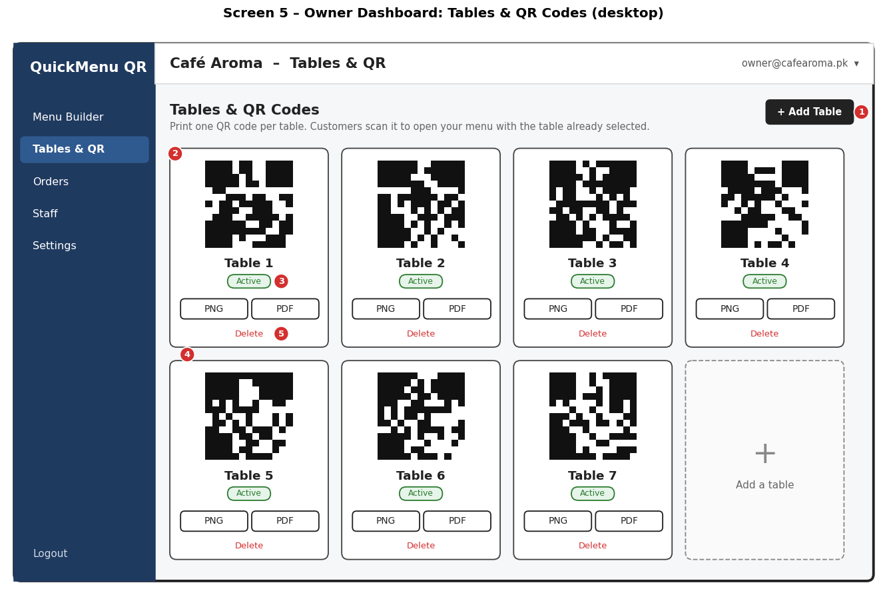
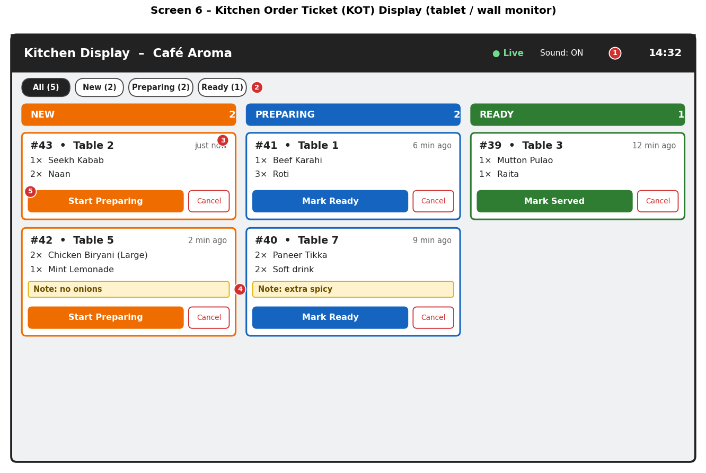

# Database Modeling, API Contracts & UI Wireframes
## QuickMenu QR – Dynamic Multi-Language Restaurant Menu & Ordering

| Field | Detail |
|---|---|
| **Project No.** | #031 |
| **Course** | Project 1 (Lab), Department of Software Engineering Technology |
| **University** | Punjab Tianjin University of Technology |
| **Faculty Advisor** | Dr. Zaigham Mushtaq |
| **Prepared by** | Muhammad Haroon |
| **Version** | 1.0 (Week 4 Submission) |
| **Input documents** | Week 2 SRS (IEEE 830) v1.0; Week 3 Architecture Document v1.0 (3-tier design, DFD Level 0 and 1) |

---

## 1. Introduction

### 1.1 Purpose
Week 3 defined the system structure and the data stores (D1 to D5). This document turns that design into three concrete, build-ready artifacts:

1. **Database model:** Entity-Relationship Diagram (ERD), data dictionary, indexing definitions, and PostgreSQL DDL.
2. **API contract:** complete REST endpoint definitions, request and response formats, error handling, and the order state machine.
3. **UI wireframes:** six primary application screens with annotated elements mapped to requirements.

### 1.2 How this document links to earlier work

| Earlier artifact | Used here for |
|---|---|
| DFD Level 1 data stores D1 to D5 | Table groups in the ERD (D1 = restaurants, users; D2 = categories, items, variants, images; D3 = tables; D4 = orders; D5 = translations) |
| DFD Level 1 processes 1.0 to 6.0 | API endpoint groups |
| SRS functional requirements FR-01 to FR-35 | Endpoint and screen traceability |
| SRS non-functional requirements | Index choices (p95 ≤ 300 ms), security rules, idempotency |

### 1.3 Contents
1. Introduction
2. Database Design (ERD, data dictionary, indexes, DDL)
3. API Contract (REST)
4. UI Wireframes
5. Traceability
6. Decisions, Risks, and Next Steps

---

## 2. Database Design

### 2.1 Design principles

| Principle | How it is applied |
|---|---|
| Relational model | PostgreSQL 14+; orders, menus, and tables have strict relationships and need transactions |
| Multi-tenancy | Every business table carries `restaurant_id` (directly or through its parent). All queries filter by it, so one restaurant can never see another's data (NFR-S6) |
| Primary keys | UUIDs (`gen_random_uuid()`), so IDs are not guessable or sequential in URLs |
| Normalization | Third Normal Form (3NF). Tags and allergens are stored as `text[]` arrays on the item (a deliberate, documented simplification, see 2.9) |
| Controlled exceptions | `order_items` stores a **snapshot** of item name and unit price, so later menu changes never alter past orders (SRS 3.5) |
| Money | `numeric(10,2)`, never floating point |
| Time | `timestamptz` (UTC); the app converts to local time (Pakistan Standard Time) |
| Integrity | Foreign keys, `CHECK` constraints, `NOT NULL`, and enums for fixed value sets |
| Deletion | `ON DELETE CASCADE` for owned children (items to variants), `SET NULL` for order history references |

### 2.2 Entity-Relationship Diagram



*Figure 1: ERD (file: QuickMenuQR_ERD.png)*

### 2.3 Entities and their purpose

| Entity | DFD Store | Purpose |
|---|---|---|
| `restaurants` | D1 | One row per restaurant (tenant); holds default language, currency, and the order counter |
| `users` | D1 | Owner and kitchen accounts with role, lockout fields |
| `password_reset_tokens` | D1 | Single-use, expiring reset tokens (stored hashed) |
| `categories` | D2 | Menu sections such as Starters and Drinks |
| `menu_items` | D2 | Dishes with price, availability, dietary tags, allergens |
| `item_variants` | D2 | Sizes or options with their own price |
| `item_images` | D2 | Up to 3 Cloudinary photos per item |
| `restaurant_tables` | D3 | Tables, each with a unique QR token |
| `orders` | D4 | Customer orders with status, total, and tracking token |
| `order_items` | D4 | Line items of an order (with price snapshot) |
| `order_status_history` | D4 | Audit trail of every status change |
| `translations` | D5 | Cache of translated names and descriptions |

### 2.4 Relationships and cardinality

| Parent | Child | Cardinality | On Delete | Meaning |
|---|---|---|---|---|
| restaurants | users | 1 : N | CASCADE | A restaurant has one owner and several kitchen staff |
| users | password_reset_tokens | 1 : N | CASCADE | A user can request several reset tokens |
| restaurants | categories | 1 : N | CASCADE | Each restaurant has its own categories |
| categories | menu_items | 1 : N | RESTRICT | A category with items cannot be dropped silently (FR-13) |
| menu_items | item_variants | 1 : N | CASCADE | Variants belong to one item |
| menu_items | item_images | 1 : N | CASCADE | Up to 3 images per item (enforced by the API and a trigger) |
| restaurants | restaurant_tables | 1 : N | CASCADE | Tables belong to a restaurant |
| restaurant_tables | orders | 1 : N | RESTRICT | Orders reference the table they came from |
| restaurants | orders | 1 : N | CASCADE | Tenant ownership of orders |
| orders | order_items | 1 : N | CASCADE | Line items |
| menu_items | order_items | 1 : N (optional) | SET NULL | Item may be deleted later; the snapshot stays |
| item_variants | order_items | 1 : N (optional) | SET NULL | Same as above |
| orders | order_status_history | 1 : N | CASCADE | Audit trail |
| users | order_status_history | 1 : N (optional) | SET NULL | Who changed the status |
| menu_items / categories / item_variants | translations | 1 : N (logical) | App-managed | Polymorphic link by `entity_type` + `entity_id` |

### 2.5 Data dictionary

#### restaurants

| Column | Type | Constraints | Description |
|---|---|---|---|
| id | uuid | PK, default `gen_random_uuid()` | Restaurant (tenant) ID |
| name | varchar(120) | NOT NULL | Display name |
| slug | varchar(80) | NOT NULL, UNIQUE | URL-safe name |
| default_language | varchar(8) | NOT NULL, default `'en'` | Language the owner writes the menu in |
| currency | char(3) | NOT NULL, default `'PKR'` | ISO currency code |
| order_counter | integer | NOT NULL, default 0 | Last issued order number (incremented in a transaction) |
| created_at / updated_at | timestamptz | NOT NULL, default `now()` | Timestamps |

#### users

| Column | Type | Constraints | Description |
|---|---|---|---|
| id | uuid | PK | User ID |
| restaurant_id | uuid | FK to restaurants, NOT NULL | Tenant |
| email | citext | NOT NULL, UNIQUE | Login (case-insensitive) |
| name | varchar(100) | NOT NULL | Full name |
| password_hash | varchar(100) | NOT NULL | bcrypt hash, cost 10 or more (NFR-S2) |
| role | user_role | NOT NULL | `owner` or `kitchen` |
| failed_attempts | smallint | NOT NULL, default 0 | Consecutive failed logins |
| locked_until | timestamptz | NULL | Lockout end time (15 min after 5 failures, NFR-S4) |
| is_active | boolean | NOT NULL, default true | Disabled accounts cannot log in |
| created_at | timestamptz | NOT NULL | Creation time |

#### password_reset_tokens

| Column | Type | Constraints | Description |
|---|---|---|---|
| id | uuid | PK | Token record ID |
| user_id | uuid | FK to users, NOT NULL | Owner of the token |
| token_hash | char(64) | NOT NULL, UNIQUE | SHA-256 of the emailed token (raw token never stored) |
| expires_at | timestamptz | NOT NULL | Valid for 30 minutes |
| used_at | timestamptz | NULL | Set when consumed (single use) |

#### categories

| Column | Type | Constraints | Description |
|---|---|---|---|
| id | uuid | PK | Category ID |
| restaurant_id | uuid | FK, NOT NULL | Tenant |
| name | varchar(80) | NOT NULL, UNIQUE per restaurant | Category name |
| display_order | integer | NOT NULL, default 0 | Position on the menu |
| is_active | boolean | NOT NULL, default true | Hide without deleting |
| created_at | timestamptz | NOT NULL | Creation time |

#### menu_items

| Column | Type | Constraints | Description |
|---|---|---|---|
| id | uuid | PK | Item ID |
| restaurant_id | uuid | FK, NOT NULL | Tenant (stored here for fast filtering) |
| category_id | uuid | FK, NOT NULL | Parent category |
| name | varchar(120) | NOT NULL | Item name |
| description | text | NULL | Short description |
| base_price | numeric(10,2) | NOT NULL, CHECK ≥ 0 | Default price |
| is_available | boolean | NOT NULL, default true | In stock or out of stock (FR-11) |
| dietary_tags | text[] | NOT NULL, default `{}` | Allowed: vegetarian, vegan, halal, gluten_free |
| allergens | text[] | NOT NULL, default `{}` | Allowed: nuts, dairy, gluten, eggs, seafood, soy |
| display_order | integer | NOT NULL, default 0 | Position inside the category |
| created_at / updated_at | timestamptz | NOT NULL | Timestamps |

#### item_variants

| Column | Type | Constraints | Description |
|---|---|---|---|
| id | uuid | PK | Variant ID |
| item_id | uuid | FK, NOT NULL | Parent item |
| name | varchar(60) | NOT NULL | For example Small, Large |
| price | numeric(10,2) | NOT NULL, CHECK ≥ 0 | Full price of this variant |
| display_order | integer | NOT NULL, default 0 | Order shown |

#### item_images

| Column | Type | Constraints | Description |
|---|---|---|---|
| id | uuid | PK | Image record ID |
| item_id | uuid | FK, NOT NULL | Parent item |
| public_id | varchar(200) | NOT NULL | Cloudinary public ID (needed for deletion) |
| url | text | NOT NULL | Cloudinary delivery URL |
| display_order | integer | NOT NULL, default 0 | First image is the cover |

#### restaurant_tables

| Column | Type | Constraints | Description |
|---|---|---|---|
| id | uuid | PK | Table ID |
| restaurant_id | uuid | FK, NOT NULL | Tenant |
| table_number | varchar(20) | NOT NULL, UNIQUE per restaurant | Label such as "5" or "Terrace 2" |
| qr_token | varchar(64) | NOT NULL, UNIQUE | Random unguessable token inside the QR URL |
| is_active | boolean | NOT NULL, default true | Inactive tables reject new orders |
| created_at | timestamptz | NOT NULL | Creation time |

#### orders

| Column | Type | Constraints | Description |
|---|---|---|---|
| id | uuid | PK | Order ID |
| restaurant_id | uuid | FK, NOT NULL | Tenant |
| table_id | uuid | FK, NOT NULL | Source table |
| order_number | integer | NOT NULL, UNIQUE per restaurant | Short human number shown to customer and kitchen |
| status | order_status | NOT NULL, default `new` | See state machine in 3.5 |
| total | numeric(10,2) | NOT NULL, CHECK ≥ 0 | Sum of line totals, calculated by the server |
| notes | text | NULL | Order-level note |
| client_request_id | uuid | NOT NULL, UNIQUE | Idempotency key from the client (NFR-R5) |
| tracking_token_hash | char(64) | NOT NULL | SHA-256 of the token that lets only this customer view the order |
| created_at / updated_at | timestamptz | NOT NULL | Timestamps |

#### order_items

| Column | Type | Constraints | Description |
|---|---|---|---|
| id | uuid | PK | Line ID |
| order_id | uuid | FK, NOT NULL | Parent order |
| item_id | uuid | FK, NULL | Original item (SET NULL if later deleted) |
| variant_id | uuid | FK, NULL | Original variant |
| item_name | varchar(120) | NOT NULL | Snapshot of name at order time |
| variant_name | varchar(60) | NULL | Snapshot of variant |
| quantity | smallint | NOT NULL, CHECK 1 to 50 | Quantity |
| unit_price | numeric(10,2) | NOT NULL | Snapshot of price at order time |
| special_instructions | text | NULL | Per-line note |

#### order_status_history

| Column | Type | Constraints | Description |
|---|---|---|---|
| id | uuid | PK | Record ID |
| order_id | uuid | FK, NOT NULL | Order |
| status | order_status | NOT NULL | New status |
| changed_by | uuid | FK users, NULL | Staff who changed it (null for system) |
| changed_at | timestamptz | NOT NULL | Time of change |

#### translations

| Column | Type | Constraints | Description |
|---|---|---|---|
| id | uuid | PK | Cache row ID |
| restaurant_id | uuid | FK, NOT NULL | Tenant |
| entity_type | translation_entity | NOT NULL | `category`, `item`, or `variant` |
| entity_id | uuid | NOT NULL | ID of that entity (logical link) |
| field | translation_field | NOT NULL | `name` or `description` |
| language | varchar(8) | NOT NULL | Target language code (for example `ur`, `ar`, `zh`) |
| source_hash | char(64) | NOT NULL | SHA-256 of the original text; if the text changes, the row is stale |
| translated_text | text | NOT NULL | Cached translation |

### 2.6 Enumerations

| Type | Values |
|---|---|
| `user_role` | owner, kitchen |
| `order_status` | new, preparing, ready, served, cancelled |
| `translation_entity` | category, item, variant |
| `translation_field` | name, description |

### 2.7 Indexing definitions

Indexes are chosen from the actual queries the system runs, to meet the SRS targets (API p95 ≤ 300 ms, order to kitchen ≤ 2 s).

| Index | Table | Definition | Type | Query or rule it supports |
|---|---|---|---|---|
| `pk_*` | all | Primary key on `id` | B-tree (automatic) | Lookup by ID |
| `ux_restaurants_slug` | restaurants | `(slug)` UNIQUE | B-tree | Unique restaurant URL |
| `ux_users_email` | users | `(email)` UNIQUE | B-tree | Login lookup and duplicate prevention (FR-01, FR-02) |
| `ix_users_restaurant` | users | `(restaurant_id)` | B-tree | Staff list per restaurant |
| `ux_prt_token_hash` | password_reset_tokens | `(token_hash)` UNIQUE | B-tree | Token verification (FR-04) |
| `ix_prt_user` | password_reset_tokens | `(user_id)` | B-tree | Invalidate old tokens |
| `ux_categories_restaurant_name` | categories | `(restaurant_id, name)` UNIQUE | B-tree | No duplicate names (UC-02) |
| `ix_categories_order` | categories | `(restaurant_id, display_order)` | B-tree | Ordered category list |
| `ix_items_restaurant_category` | menu_items | `(restaurant_id, category_id, display_order)` | B-tree (composite) | **Main menu query** for the customer page (FR-18) |
| `ix_items_available` | menu_items | `(restaurant_id) WHERE is_available` | B-tree, partial | Fast listing of in-stock items only |
| `ix_items_dietary` | menu_items | `(dietary_tags)` | GIN | Dietary filter using `@>` (FR-22) |
| `ix_items_allergens` | menu_items | `(allergens)` | GIN | Allergen filter using `&&` (FR-22) |
| `ix_items_name_trgm` | menu_items | `(name gin_trgm_ops)` | GIN (pg_trgm) | Search by name, partial and typo tolerant (FR-19) |
| `ix_variants_item` | item_variants | `(item_id, display_order)` | B-tree | Load variants with an item |
| `ix_images_item` | item_images | `(item_id, display_order)` | B-tree | Load photos with an item |
| `ux_tables_qr_token` | restaurant_tables | `(qr_token)` UNIQUE | B-tree | **Every customer scan** resolves the table by token (FR-17) |
| `ux_tables_restaurant_number` | restaurant_tables | `(restaurant_id, table_number)` UNIQUE | B-tree | No duplicate table numbers (UC-05) |
| `ux_orders_client_request` | orders | `(client_request_id)` UNIQUE | B-tree | Duplicate-order prevention (NFR-R5) |
| `ux_orders_restaurant_number` | orders | `(restaurant_id, order_number)` UNIQUE | B-tree | Unique order number per restaurant |
| `ix_orders_active` | orders | `(restaurant_id, created_at) WHERE status IN ('new','preparing','ready')` | B-tree, partial | **Kitchen screen query** and `kot:sync` (FR-30, FR-34); stays tiny because finished orders are excluded |
| `ix_orders_history` | orders | `(restaurant_id, created_at DESC)` | B-tree | Owner order history by date (FR-35) |
| `ix_orders_table` | orders | `(table_id, created_at DESC)` | B-tree | Orders per table |
| `ix_order_items_order` | order_items | `(order_id)` | B-tree | Load lines of an order |
| `ix_history_order` | order_status_history | `(order_id, changed_at)` | B-tree | Status timeline |
| `ux_translations_key` | translations | `(entity_type, entity_id, field, language)` UNIQUE | B-tree | **Cache lookup** and upsert (FR-20, NFR-P4) |
| `ix_translations_restaurant` | translations | `(restaurant_id)` | B-tree | Purge a restaurant's cache |

**Index rules followed**
- Every foreign key column that is queried has an index (PostgreSQL does not create these automatically).
- Composite indexes put the equality column (`restaurant_id`) first, then the sort column.
- Partial indexes are used where only a small subset of rows is hot (active orders, available items).
- No index is added "just in case"; write cost on `orders` is kept low because orders are inserted frequently.

### 2.8 Key query patterns

| # | Query | SQL (simplified) | Index used |
|---|---|---|---|
| Q1 | Customer menu for a scanned table | `SELECT t.id, t.restaurant_id FROM restaurant_tables t WHERE t.qr_token = $1 AND t.is_active;` then `SELECT c.name, i.* FROM categories c JOIN menu_items i ON i.category_id = c.id WHERE c.restaurant_id = $1 AND c.is_active ORDER BY c.display_order, i.display_order;` | `ux_tables_qr_token`, `ix_items_restaurant_category` |
| Q2 | Filter vegetarian, exclude nuts | `... WHERE restaurant_id = $1 AND dietary_tags @> ARRAY['vegetarian'] AND NOT (allergens && ARRAY['nuts']);` | `ix_items_dietary` for the include rule; the exclusion is applied on the already small restaurant-scoped result (a restaurant has far fewer than 500 items) |
| Q3 | Active orders for the kitchen | `SELECT * FROM orders WHERE restaurant_id = $1 AND status IN ('new','preparing','ready') ORDER BY created_at;` | `ix_orders_active` |
| Q4 | Place order (inside one transaction) | `UPDATE restaurants SET order_counter = order_counter + 1 WHERE id = $1 RETURNING order_counter;` then `INSERT orders ... ON CONFLICT (client_request_id) DO NOTHING;` then `INSERT order_items ...;` then `INSERT order_status_history ...;` | `ux_orders_client_request` |
| Q5 | Translation cache lookup | `SELECT translated_text FROM translations WHERE entity_type = $1 AND entity_id = $2 AND field = $3 AND language = $4 AND source_hash = $5;` | `ux_translations_key` |

### 2.9 Business rules enforced in the database

| Rule | Mechanism |
|---|---|
| Price never negative | `CHECK (base_price >= 0)`, `CHECK (price >= 0)` |
| Quantity from 1 to 50 | `CHECK (quantity BETWEEN 1 AND 50)` |
| Valid tags and allergens only | `CHECK (dietary_tags <@ ARRAY[...])` and `CHECK (allergens <@ ARRAY[...])` |
| At most 3 images per item | Trigger `trg_limit_item_images` raises an error on the 4th insert |
| No duplicate order on retry | `UNIQUE (client_request_id)` plus `ON CONFLICT DO NOTHING` |
| No two restaurants share a table token | `UNIQUE (qr_token)` |
| Past orders never change when the menu changes | Snapshot columns `item_name`, `variant_name`, `unit_price` |
| Every status change is logged | Application writes to `order_status_history` in the same transaction as the status update |

**Design note on arrays:** storing tags and allergens as `text[]` keeps the item model simple and fast with GIN indexes. The trade-off is that the allowed values live in a `CHECK` constraint rather than a lookup table. If owners later need custom tags, they can be moved to `tags` and `item_tags` tables without changing the API.

### 2.10 PostgreSQL DDL

```sql
-- Extensions
CREATE EXTENSION IF NOT EXISTS pgcrypto;   -- gen_random_uuid()
CREATE EXTENSION IF NOT EXISTS citext;     -- case-insensitive email
CREATE EXTENSION IF NOT EXISTS pg_trgm;    -- fuzzy name search

-- Enumerations
CREATE TYPE user_role          AS ENUM ('owner', 'kitchen');
CREATE TYPE order_status       AS ENUM ('new', 'preparing', 'ready', 'served', 'cancelled');
CREATE TYPE translation_entity AS ENUM ('category', 'item', 'variant');
CREATE TYPE translation_field  AS ENUM ('name', 'description');

-- D1: restaurants and users
CREATE TABLE restaurants (
  id               UUID PRIMARY KEY DEFAULT gen_random_uuid(),
  name             VARCHAR(120) NOT NULL,
  slug             VARCHAR(80)  NOT NULL UNIQUE,
  default_language VARCHAR(8)   NOT NULL DEFAULT 'en',
  currency         CHAR(3)      NOT NULL DEFAULT 'PKR',
  order_counter    INTEGER      NOT NULL DEFAULT 0,
  created_at       TIMESTAMPTZ  NOT NULL DEFAULT now(),
  updated_at       TIMESTAMPTZ  NOT NULL DEFAULT now()
);

CREATE TABLE users (
  id              UUID PRIMARY KEY DEFAULT gen_random_uuid(),
  restaurant_id   UUID         NOT NULL REFERENCES restaurants(id) ON DELETE CASCADE,
  email           CITEXT       NOT NULL UNIQUE,
  name            VARCHAR(100) NOT NULL,
  password_hash   VARCHAR(100) NOT NULL,
  role            user_role    NOT NULL,
  failed_attempts SMALLINT     NOT NULL DEFAULT 0,
  locked_until    TIMESTAMPTZ,
  is_active       BOOLEAN      NOT NULL DEFAULT TRUE,
  created_at      TIMESTAMPTZ  NOT NULL DEFAULT now()
);
CREATE INDEX ix_users_restaurant ON users (restaurant_id);

CREATE TABLE password_reset_tokens (
  id         UUID PRIMARY KEY DEFAULT gen_random_uuid(),
  user_id    UUID        NOT NULL REFERENCES users(id) ON DELETE CASCADE,
  token_hash CHAR(64)    NOT NULL UNIQUE,
  expires_at TIMESTAMPTZ NOT NULL,
  used_at    TIMESTAMPTZ
);
CREATE INDEX ix_prt_user ON password_reset_tokens (user_id);

-- D2: menu
CREATE TABLE categories (
  id            UUID PRIMARY KEY DEFAULT gen_random_uuid(),
  restaurant_id UUID        NOT NULL REFERENCES restaurants(id) ON DELETE CASCADE,
  name          VARCHAR(80) NOT NULL,
  display_order INTEGER     NOT NULL DEFAULT 0,
  is_active     BOOLEAN     NOT NULL DEFAULT TRUE,
  created_at    TIMESTAMPTZ NOT NULL DEFAULT now(),
  CONSTRAINT ux_categories_restaurant_name UNIQUE (restaurant_id, name)
);
CREATE INDEX ix_categories_order ON categories (restaurant_id, display_order);

CREATE TABLE menu_items (
  id            UUID PRIMARY KEY DEFAULT gen_random_uuid(),
  restaurant_id UUID          NOT NULL REFERENCES restaurants(id) ON DELETE CASCADE,
  category_id   UUID          NOT NULL REFERENCES categories(id) ON DELETE RESTRICT,
  name          VARCHAR(120)  NOT NULL,
  description   TEXT,
  base_price    NUMERIC(10,2) NOT NULL CHECK (base_price >= 0),
  is_available  BOOLEAN       NOT NULL DEFAULT TRUE,
  dietary_tags  TEXT[]        NOT NULL DEFAULT '{}'
                CHECK (dietary_tags <@ ARRAY['vegetarian','vegan','halal','gluten_free']),
  allergens     TEXT[]        NOT NULL DEFAULT '{}'
                CHECK (allergens <@ ARRAY['nuts','dairy','gluten','eggs','seafood','soy']),
  display_order INTEGER       NOT NULL DEFAULT 0,
  created_at    TIMESTAMPTZ   NOT NULL DEFAULT now(),
  updated_at    TIMESTAMPTZ   NOT NULL DEFAULT now()
);
CREATE INDEX ix_items_restaurant_category ON menu_items (restaurant_id, category_id, display_order);
CREATE INDEX ix_items_available ON menu_items (restaurant_id) WHERE is_available;
CREATE INDEX ix_items_dietary   ON menu_items USING GIN (dietary_tags);
CREATE INDEX ix_items_allergens ON menu_items USING GIN (allergens);
CREATE INDEX ix_items_name_trgm ON menu_items USING GIN (name gin_trgm_ops);

CREATE TABLE item_variants (
  id            UUID PRIMARY KEY DEFAULT gen_random_uuid(),
  item_id       UUID          NOT NULL REFERENCES menu_items(id) ON DELETE CASCADE,
  name          VARCHAR(60)   NOT NULL,
  price         NUMERIC(10,2) NOT NULL CHECK (price >= 0),
  display_order INTEGER       NOT NULL DEFAULT 0
);
CREATE INDEX ix_variants_item ON item_variants (item_id, display_order);

CREATE TABLE item_images (
  id            UUID PRIMARY KEY DEFAULT gen_random_uuid(),
  item_id       UUID         NOT NULL REFERENCES menu_items(id) ON DELETE CASCADE,
  public_id     VARCHAR(200) NOT NULL,
  url           TEXT         NOT NULL,
  display_order INTEGER      NOT NULL DEFAULT 0
);
CREATE INDEX ix_images_item ON item_images (item_id, display_order);

-- D3: tables and QR
CREATE TABLE restaurant_tables (
  id            UUID PRIMARY KEY DEFAULT gen_random_uuid(),
  restaurant_id UUID        NOT NULL REFERENCES restaurants(id) ON DELETE CASCADE,
  table_number  VARCHAR(20) NOT NULL,
  qr_token      VARCHAR(64) NOT NULL UNIQUE,
  is_active     BOOLEAN     NOT NULL DEFAULT TRUE,
  created_at    TIMESTAMPTZ NOT NULL DEFAULT now(),
  CONSTRAINT ux_tables_restaurant_number UNIQUE (restaurant_id, table_number)
);

-- D4: orders
CREATE TABLE orders (
  id                  UUID PRIMARY KEY DEFAULT gen_random_uuid(),
  restaurant_id       UUID          NOT NULL REFERENCES restaurants(id) ON DELETE CASCADE,
  table_id            UUID          NOT NULL REFERENCES restaurant_tables(id) ON DELETE RESTRICT,
  order_number        INTEGER       NOT NULL,
  status              order_status  NOT NULL DEFAULT 'new',
  total               NUMERIC(10,2) NOT NULL CHECK (total >= 0),
  notes               TEXT,
  client_request_id   UUID          NOT NULL UNIQUE,
  tracking_token_hash CHAR(64)      NOT NULL,
  created_at          TIMESTAMPTZ   NOT NULL DEFAULT now(),
  updated_at          TIMESTAMPTZ   NOT NULL DEFAULT now(),
  CONSTRAINT ux_orders_restaurant_number UNIQUE (restaurant_id, order_number)
);
CREATE INDEX ix_orders_active  ON orders (restaurant_id, created_at)
  WHERE status IN ('new', 'preparing', 'ready');
CREATE INDEX ix_orders_history ON orders (restaurant_id, created_at DESC);
CREATE INDEX ix_orders_table   ON orders (table_id, created_at DESC);

CREATE TABLE order_items (
  id                   UUID PRIMARY KEY DEFAULT gen_random_uuid(),
  order_id             UUID          NOT NULL REFERENCES orders(id) ON DELETE CASCADE,
  item_id              UUID          REFERENCES menu_items(id)    ON DELETE SET NULL,
  variant_id           UUID          REFERENCES item_variants(id) ON DELETE SET NULL,
  item_name            VARCHAR(120)  NOT NULL,
  variant_name         VARCHAR(60),
  quantity             SMALLINT      NOT NULL CHECK (quantity BETWEEN 1 AND 50),
  unit_price           NUMERIC(10,2) NOT NULL CHECK (unit_price >= 0),
  special_instructions TEXT
);
CREATE INDEX ix_order_items_order ON order_items (order_id);

CREATE TABLE order_status_history (
  id         UUID PRIMARY KEY DEFAULT gen_random_uuid(),
  order_id   UUID         NOT NULL REFERENCES orders(id) ON DELETE CASCADE,
  status     order_status NOT NULL,
  changed_by UUID         REFERENCES users(id) ON DELETE SET NULL,
  changed_at TIMESTAMPTZ  NOT NULL DEFAULT now()
);
CREATE INDEX ix_history_order ON order_status_history (order_id, changed_at);

-- D5: translation cache
CREATE TABLE translations (
  id              UUID PRIMARY KEY DEFAULT gen_random_uuid(),
  restaurant_id   UUID               NOT NULL REFERENCES restaurants(id) ON DELETE CASCADE,
  entity_type     translation_entity NOT NULL,
  entity_id       UUID               NOT NULL,
  field           translation_field  NOT NULL,
  language        VARCHAR(8)         NOT NULL,
  source_hash     CHAR(64)           NOT NULL,
  translated_text TEXT               NOT NULL,
  CONSTRAINT ux_translations_key UNIQUE (entity_type, entity_id, field, language)
);
CREATE INDEX ix_translations_restaurant ON translations (restaurant_id);

-- Rule: at most 3 images per item
CREATE FUNCTION limit_item_images() RETURNS trigger AS $$
BEGIN
  IF (SELECT count(*) FROM item_images WHERE item_id = NEW.item_id) >= 3 THEN
    RAISE EXCEPTION 'An item can have at most 3 images';
  END IF;
  RETURN NEW;
END;
$$ LANGUAGE plpgsql;

CREATE TRIGGER trg_limit_item_images
  BEFORE INSERT ON item_images
  FOR EACH ROW EXECUTE FUNCTION limit_item_images();
```

### 2.11 Data lifecycle and protection
- **Backups:** daily automated backups by the managed provider, with a restore test before the pilot (RPO ≤ 24 h, RTO ≤ 4 h).
- **Migrations:** schema changes are written as versioned migration files kept in Git and applied automatically in CI/CD; never edited by hand in production.
- **Seed data:** a demo restaurant with 4 categories, 12 items, and 7 tables for development and the advisor demo.
- **Retention:** orders are kept for reporting; translation cache rows may be purged at any time because they can be regenerated.
- **Privacy:** no customer personal data is stored (NFR-S7). Passwords and tokens are stored only as hashes.

---

## 3. API Contract (REST)

### 3.1 Style decision: REST over GraphQL

| Factor | REST | GraphQL | Decision |
|---|---|---|---|
| Fit for this app | Clear resources (menu, tables, orders) | Better for deeply nested, varied client queries | Our screens need fixed, predictable data |
| Public menu caching | Easy HTTP and CDN caching of `GET` | Harder (single POST endpoint) | REST helps meet the ≤ 2.5 s load target |
| Rate limiting and security | Per endpoint, simple | Needs query-cost analysis | REST is simpler and safer for a small team |
| Learning and tooling | Express, OpenAPI, Postman | Extra server and schema layer | REST fits the timeline |
| Real-time | Handled by WebSockets either way | Subscriptions add complexity | Keep the Week 3 WebSocket design |

**Conclusion:** the system uses a **REST JSON API** for requests and **WebSockets** for live events. GraphQL can be reconsidered later if more client types appear.

### 3.2 General conventions

| Topic | Rule |
|---|---|
| Base URL | `https://api.quickmenu.example/api/v1` (version in the path) |
| Format | JSON (`Content-Type: application/json`), UTF-8; field names in camelCase |
| Authentication | `Authorization: Bearer <accessToken>` (JWT, expires in 60 minutes). Refresh token in an HttpOnly, Secure cookie (7 days) |
| Public endpoints | Under `/public/...`; need no login; identified by the table's `qrToken` |
| Roles | `owner` (full access), `kitchen` (orders only) |
| Tenant isolation | `restaurantId` always comes from the token or QR token, never from the request body |
| IDs | UUID strings |
| Money | Numbers with 2 decimals plus a `currency` field |
| Dates | ISO 8601 UTC, for example `2026-10-16T09:32:00Z` |
| Success envelope | `{ "data": ... }`; lists add `"meta": { "page", "pageSize", "total" }` |
| Pagination | `?page=1&pageSize=20` (default 20, max 100) |
| Idempotency | `POST /public/orders` requires header `Idempotency-Key: <uuid>`; the same key returns the original order |
| Rate limits | 100 requests per minute per IP overall (NFR-S8); login 10 per minute; order creation 5 per minute per table and IP. Headers: `X-RateLimit-Limit`, `X-RateLimit-Remaining`; excess returns `429` |
| Request tracing | Every response carries `X-Request-Id` |
| CORS | Only the production and staging front-end origins |

### 3.3 Error format

```json
{
  "error": {
    "code": "VALIDATION_ERROR",
    "message": "One or more fields are invalid.",
    "details": [
      { "field": "basePrice", "issue": "must be greater than or equal to 0" }
    ],
    "requestId": "9f1c2e0a-5b8d-4e6f-a1c3-2d7b9e4f0a11"
  }
}
```

| HTTP | Code | When |
|---|---|---|
| 400 | `VALIDATION_ERROR` | Missing or invalid fields |
| 401 | `UNAUTHENTICATED` | Missing, invalid, or expired token |
| 401 | `INVALID_CREDENTIALS` | Wrong email or password |
| 403 | `FORBIDDEN` | Role not allowed |
| 404 | `NOT_FOUND` | Resource missing or belongs to another restaurant |
| 409 | `CONFLICT` | Duplicate name, email, or table number |
| 409 | `ITEM_UNAVAILABLE` | Ordered item is out of stock (lists the items) |
| 409 | `INVALID_STATUS_TRANSITION` | Status change not allowed |
| 409 | `CATEGORY_NOT_EMPTY` | Deleting a category that still has items without `force=true` |
| 413 | `PAYLOAD_TOO_LARGE` | Upload over the limit |
| 422 | `TABLE_INACTIVE` | Table is disabled or the QR token is invalid |
| 423 | `ACCOUNT_LOCKED` | Too many failed logins (15-minute lock) |
| 429 | `RATE_LIMITED` | Rate limit exceeded |
| 500 | `INTERNAL_ERROR` | Unexpected server error (no internal details leaked) |
| 503 | `TRANSLATION_UNAVAILABLE` | Translation service down (menu still returns in the original language with a warning) |

### 3.4 Endpoint catalogue

Auth column: **P** = public, **A** = any logged-in user, **O** = owner, **K** = kitchen or owner, **T** = tracking token.

#### 3.4.1 Authentication and accounts (Process 1.0)

| Method | Path | Auth | Purpose | Success | Req. |
|---|---|---|---|---|---|
| POST | `/auth/register` | P | Create restaurant and owner account | 201 | FR-01 |
| POST | `/auth/login` | P | Log in, receive tokens | 200 | FR-02 |
| POST | `/auth/refresh` | cookie | Get a new access token | 200 | FR-03, NFR-S3 |
| POST | `/auth/logout` | A | End the session | 204 | FR-03 |
| POST | `/auth/forgot-password` | P | Email a reset link | 202 | FR-04 |
| POST | `/auth/reset-password` | P | Set a new password with the token | 204 | FR-04 |
| GET | `/me` | A | Current user and restaurant | 200 | FR-05 |
| GET | `/staff` | O | List kitchen accounts | 200 | FR-05 |
| POST | `/staff` | O | Create a kitchen account | 201 | FR-05 |
| PATCH | `/staff/{id}` | O | Update, deactivate, or reset password | 200 | FR-05 |
| DELETE | `/staff/{id}` | O | Remove a kitchen account | 204 | FR-05 |
| GET | `/restaurant` | A | Restaurant profile | 200 | FR-01 |
| PATCH | `/restaurant` | O | Edit name, default language, currency | 200 | FR-01 |

#### 3.4.2 Menu management (Process 2.0)

| Method | Path | Auth | Purpose | Success | Req. |
|---|---|---|---|---|---|
| GET | `/categories` | O | List categories with item counts | 200 | FR-06 |
| POST | `/categories` | O | Create a category | 201 | FR-06 |
| PATCH | `/categories/{id}` | O | Rename or hide | 200 | FR-06 |
| PUT | `/categories/order` | O | Save new display order | 200 | FR-06 |
| DELETE | `/categories/{id}?force=true` | O | Delete (warns if it has items) | 204 | FR-06, FR-13 |
| GET | `/items?categoryId=&q=&page=` | O | List items | 200 | FR-07 |
| POST | `/items` | O | Create an item (with variants) | 201 | FR-07, FR-08, FR-10 |
| GET | `/items/{id}` | O | Item detail | 200 | FR-07 |
| PATCH | `/items/{id}` | O | Edit item, price, tags | 200 | FR-07, FR-12 |
| PATCH | `/items/{id}/availability` | O | Mark in stock or out of stock | 200 | FR-11 |
| DELETE | `/items/{id}` | O | Delete an item | 204 | FR-07 |
| POST | `/items/{id}/variants` | O | Add a variant | 201 | FR-08 |
| PATCH | `/variants/{id}` | O | Edit a variant | 200 | FR-08 |
| DELETE | `/variants/{id}` | O | Delete a variant | 204 | FR-08 |
| POST | `/media/upload-signature` | O | Get a signed Cloudinary upload signature | 200 | FR-09 |
| POST | `/items/{id}/images` | O | Save an uploaded image reference (max 3) | 201 | FR-09 |
| DELETE | `/images/{id}` | O | Delete an image (also from Cloudinary) | 204 | FR-09 |

#### 3.4.3 Tables and QR codes (Process 3.0)

| Method | Path | Auth | Purpose | Success | Req. |
|---|---|---|---|---|---|
| GET | `/tables` | O | List tables with QR links | 200 | FR-14 |
| POST | `/tables` | O | Create a table and its QR token | 201 | FR-14, FR-15 |
| PATCH | `/tables/{id}` | O | Rename, activate, deactivate | 200 | FR-14 |
| DELETE | `/tables/{id}` | O | Delete (blocked if it has orders; deactivate instead) | 204 | FR-14 |
| GET | `/tables/{id}/qr?format=png\|pdf` | O | Download printable QR code | 200 (file) | FR-16 |

#### 3.4.4 Customer endpoints (Processes 4.0 and 5.0)

| Method | Path | Auth | Purpose | Success | Req. |
|---|---|---|---|---|---|
| GET | `/public/menu/{qrToken}?lang=&dietary=&exclude=&q=` | P | Menu for the scanned table with language, filters, search | 200 | FR-17 to FR-22 |
| GET | `/public/languages` | P | Supported languages list | 200 | FR-20 |
| POST | `/public/orders` | P + Idempotency-Key | Place an order | 201 | FR-23 to FR-28 |
| GET | `/public/orders/{id}` | T (`X-Tracking-Token`) | Current status of own order | 200 | FR-29 |

#### 3.4.5 Kitchen and order management (Process 6.0)

| Method | Path | Auth | Purpose | Success | Req. |
|---|---|---|---|---|---|
| GET | `/orders?status=&from=&to=&page=` | K | Active orders or history | 200 | FR-30, FR-35 |
| GET | `/orders/{id}` | K | Order detail with timeline | 200 | FR-31 |
| PATCH | `/orders/{id}/status` | K | Change order status | 200 | FR-33 |

#### 3.4.6 System

| Method | Path | Auth | Purpose | Success |
|---|---|---|---|---|
| GET | `/health` | P | Health check for uptime monitoring | 200 |

**Total: 43 endpoints** (the table above lists each one once).

### 3.5 Detailed contracts for key endpoints

#### POST `/auth/login`
Request
```json
{ "email": "owner@cafearoma.pk", "password": "S3cure!pass" }
```

Response `200`
```json
{
  "data": {
    "accessToken": "eyJhbGciOiJIUzI1NiIs...",
    "expiresIn": 3600,
    "user": {
      "id": "7c1f0b9e-3a52-4c0e-9d11-5b0a2f6c8e01",
      "name": "Bilal Ahmed",
      "email": "owner@cafearoma.pk",
      "role": "owner",
      "restaurantId": "d2a4e7f0-91b3-4c58-8a6e-0f3b7c1d2e55"
    }
  }
}
```

Errors: `401 INVALID_CREDENTIALS`, `423 ACCOUNT_LOCKED`, `429 RATE_LIMITED`.

#### POST `/items`
Request (owner)
```json
{
  "categoryId": "4b8e1c2d-7a90-4f31-b6c5-9d0e3a1f2b77",
  "name": "Chicken Biryani",
  "description": "Basmati rice, spiced chicken",
  "basePrice": 450.00,
  "dietaryTags": ["halal"],
  "allergens": ["dairy"],
  "variants": [
    { "name": "Small", "price": 450.00 },
    { "name": "Large", "price": 650.00 }
  ]
}
```

Response `201`
```json
{
  "data": {
    "id": "a91c7d3e-0b24-4e8f-93a6-1c5d7e9f0a12",
    "categoryId": "4b8e1c2d-7a90-4f31-b6c5-9d0e3a1f2b77",
    "name": "Chicken Biryani",
    "description": "Basmati rice, spiced chicken",
    "basePrice": 450.00,
    "currency": "PKR",
    "isAvailable": true,
    "dietaryTags": ["halal"],
    "allergens": ["dairy"],
    "variants": [
      { "id": "e3f2...", "name": "Small", "price": 450.00 },
      { "id": "f4a3...", "name": "Large", "price": 650.00 }
    ],
    "images": []
  }
}
```

Validation: `name` 1 to 120 characters; `basePrice` 0 to 1,000,000; `dietaryTags` and `allergens` only from the allowed lists; at most 10 variants; unique variant names per item.

#### PATCH `/items/{id}/availability`

Request: `{ "isAvailable": false }`

Response `200`: `{ "data": { "id": "a91c...", "isAvailable": false } }`

Side effect: customer menus update on the next load (cache lifetime of 5 seconds for the public menu), meeting the 2-second update goal for open pages through a `menu:updated` WebSocket event.

#### GET `/public/menu/{qrToken}?lang=ur&dietary=vegetarian&exclude=nuts&q=pan`

Response `200`
```json
{
  "data": {
    "restaurant": { "name": "Café Aroma", "currency": "PKR", "defaultLanguage": "en" },
    "table": { "id": "b7d2...", "number": "5" },
    "language": "ur",
    "categories": [
      {
        "id": "4b8e...",
        "name": "Starters",
        "items": [
          {
            "id": "c8e3...",
            "name": "Paneer Tikka",
            "description": "Grilled cottage cheese",
            "price": 480.00,
            "variants": [],
            "images": [{ "url": "https://res.cloudinary.com/.../w_400,q_auto/..." }],
            "dietaryTags": ["vegetarian"],
            "allergens": ["dairy"],
            "isAvailable": true
          }
        ]
      }
    ]
  },
  "warnings": []
}
```
If translation fails: `warnings: ["TRANSLATION_UNAVAILABLE"]` and text is returned in the default language. Errors: `404 NOT_FOUND` or `422 TABLE_INACTIVE` for a bad QR token.

#### POST `/public/orders`

Headers: `Idempotency-Key: 5d0f3b1e-8a44-4c7e-9b21-6a3c2e1d0f99`
Request
```json
{
  "qrToken": "k3J9xQ2mV7pL0aZs",
  "items": [
    { "itemId": "a91c...", "variantId": "f4a3...", "quantity": 2, "specialInstructions": "no onions" },
    { "itemId": "d5b1...", "variantId": null, "quantity": 1 }
  ],
  "notes": "Please serve together"
}
```

Response `201`
```json
{
  "data": {
    "id": "0e7a9c14-2b36-4d58-a1f0-3c9e5b7d2a46",
    "orderNumber": 42,
    "status": "new",
    "table": { "number": "5" },
    "items": [
      { "name": "Chicken Biryani", "variant": "Large", "quantity": 2, "unitPrice": 650.00 },
      { "name": "Mint Lemonade", "variant": null, "quantity": 1, "unitPrice": 150.00 }
    ],
    "total": 1450.00,
    "currency": "PKR",
    "trackingToken": "t_9f2b7e1c4a6d8035",
    "createdAt": "2026-10-16T09:32:00Z"
  }
}
```
Server rules: re-reads every price and availability from the database (client prices are ignored); calculates the total; writes the order, lines, history, and counter in one transaction; then emits `order:new`. Errors: `409 ITEM_UNAVAILABLE` with `details: [{ "itemId": "...", "name": "Daal Makhni" }]`, `422 TABLE_INACTIVE`, `400 VALIDATION_ERROR` (quantity outside 1 to 50, more than 30 lines, empty cart), `429 RATE_LIMITED`. A repeated `Idempotency-Key` returns `200` with the original order and creates nothing new.

#### GET `/public/orders/{id}`

Header: `X-Tracking-Token: t_9f2b7e1c4a6d8035`

Response `200`
```json
{
  "data": {
    "id": "0e7a...",
    "orderNumber": 42,
    "status": "preparing",
    "timeline": [
      { "status": "new", "at": "2026-10-16T09:32:00Z" },
      { "status": "preparing", "at": "2026-10-16T09:34:10Z" }
    ],
    "items": [ ... ],
    "total": 1450.00
  }
}
```
A wrong or missing token returns `404` (never reveals that the order exists).

#### GET `/orders?status=new,preparing,ready`

Response `200` (kitchen, newest last)
```json
{
  "data": [
    {
      "id": "0e7a...",
      "orderNumber": 42,
      "table": { "number": "5" },
      "status": "new",
      "notes": "Please serve together",
      "items": [
        { "name": "Chicken Biryani", "variant": "Large", "quantity": 2, "specialInstructions": "no onions" }
      ],
      "createdAt": "2026-10-16T09:32:00Z"
    }
  ],
  "meta": { "page": 1, "pageSize": 20, "total": 5 }
}
```

#### PATCH `/orders/{id}/status`

Request: `{ "status": "preparing" }`

Response `200`: `{ "data": { "id": "0e7a...", "status": "preparing", "updatedAt": "2026-10-16T09:34:10Z" } }`

Errors: `409 INVALID_STATUS_TRANSITION` (see 3.6). Side effects: row added to `order_status_history`; event `order:status` emitted to the KOT room and the customer's order room.

#### POST `/tables`

Request: `{ "tableNumber": "8" }`

Response `201`
```json
{
  "data": {
    "id": "f1a9...",
    "tableNumber": "8",
    "isActive": true,
    "menuUrl": "https://menu.quickmenu.example/m/k3J9xQ2mV7pL0aZs",
    "qrDownload": { "png": "/tables/f1a9.../qr?format=png", "pdf": "/tables/f1a9.../qr?format=pdf" }
  }
}
```
The QR token is 16 or more random characters generated with a cryptographically secure generator.

### 3.6 Order status state machine

| From | Allowed next status | Who |
|---|---|---|
| new | preparing, cancelled | kitchen, owner |
| preparing | ready, cancelled | kitchen, owner |
| ready | served, cancelled | kitchen, owner |
| served | none (final) | not applicable |
| cancelled | none (final) | not applicable |

Any other change returns `409 INVALID_STATUS_TRANSITION`.

### 3.7 WebSocket contract (from Week 3, finalized)

| Item | Detail |
|---|---|
| URL | `wss://api.quickmenu.example/ws` |
| KOT connection | Connect with the staff JWT; the server joins the socket to room `restaurant:{id}` |
| Customer connection | Connect with `orderId` and `trackingToken`; joined to room `order:{id}` |

| Event | Direction | Payload |
|---|---|---|
| `order:new` | Server to KOT | Full order object (same shape as `GET /orders`) |
| `order:status` | Server to KOT and customer | `{ orderId, status, at }` |
| `order:update_status` | KOT to server | `{ orderId, status }` (validated with the same state machine) |
| `kot:sync` | Server to KOT on connect or reconnect | All active orders |
| `menu:updated` | Server to open customer menus | `{ itemId, isAvailable }` |

### 3.8 Security rules for the API
- Every owner and kitchen endpoint checks the JWT, the role, and that the resource belongs to the token's restaurant; a mismatch returns `404`.
- All input is validated with a schema (type, length, range) before use; SQL always uses parameters.
- Passwords are hashed with bcrypt; reset tokens and tracking tokens are stored only as SHA-256 hashes.
- Public endpoints return only customer-safe fields (no internal IDs of staff, no cost data).
- Image uploads go straight to Cloudinary using a short-lived signature; the API only stores the returned reference.
- The API is documented as an OpenAPI 3 file kept in the repository so the front end and tests use the same contract.

---

## 4. UI Wireframes

### 4.1 Design principles

| Principle | Application |
|---|---|
| Mobile-first for customers | Layout designed at 360 px wide; thumb-reachable actions at the bottom |
| No login for customers | The QR scan opens the menu directly (FR-17) |
| Few taps to order | Add, view cart, place order: 6 taps or fewer (NFR-U1) |
| Large touch targets | At least 44 × 44 px (NFR-U5) |
| Clear status | Out-of-stock items are visibly disabled; order progress is always visible |
| Owner simplicity | Two-panel menu builder with a side drawer for editing; one item added in about 2 minutes (NFR-U2) |
| Kitchen readability | Large text, color-coded columns, one-tap status buttons, audible alert |
| Accessibility | WCAG 2.1 AA contrast, text labels with icons, language selector on every customer screen |

### 4.2 Screen inventory

| # | Screen | User | Device | File |
|---|---|---|---|---|
| 1 | Customer Menu | Customer | Phone | QuickMenuQR_Wireframe_1_CustomerMenu.png |
| 2 | Cart & Place Order | Customer | Phone | QuickMenuQR_Wireframe_2_CartOrder.png |
| 3 | Order Status | Customer | Phone | QuickMenuQR_Wireframe_3_OrderStatus.png |
| 4 | Menu Builder | Owner | Desktop or laptop | QuickMenuQR_Wireframe_4_MenuBuilder.png |
| 5 | Tables & QR Codes | Owner | Desktop or laptop | QuickMenuQR_Wireframe_5_TablesQR.png |
| 6 | Kitchen Order Ticket Display | Kitchen staff | Tablet or wall monitor | QuickMenuQR_Wireframe_6_KitchenDisplay.png |

Login, registration, and staff-management forms follow standard patterns and will be designed together with the final UI in the build phase.

### 4.3 Navigation flow

```
CUSTOMER (no login)
  Scan QR  ->  [1 Customer Menu] --(+ Add)--> [1 Customer Menu with cart bar]
                                                        |
                                                  View cart
                                                        v
                                              [2 Cart & Place Order]
                                                        |
                                                  Place Order
                                                        v
                                              [3 Order Status]  <-- live updates
                                                        |
                                                  Back to menu --> [1]

OWNER (login required)
  Login -> [4 Menu Builder] <-> [5 Tables & QR Codes]  (side navigation)
           (Orders, Staff, Settings in the same navigation)

KITCHEN (login required)
  Login -> [6 Kitchen Display]
```

### 4.4 Screen 1: Customer Menu



| # | Element | Behavior | Req. |
|---|---|---|---|
| 1 | Language selector | Opens the language list; menu text switches and the choice is remembered for the session | FR-20, FR-21, UC-07 |
| 2 | Search box | Filters items by name as the customer types | FR-19 |
| 3 | Dietary and allergen chips | Tap to include or exclude; selected chip is filled dark | FR-22, UC-08 |
| 4 | Category tabs | Sticky tabs; tapping scrolls to the category | FR-18 |
| 5 | Item card | Photo, name, short description, dietary tag, price (range if variants), and the **+ Add** button (variants are chosen in a small sheet) | FR-18, UC-06 |
| 6 | Out-of-stock card | Greyed out with a red "Out of stock" label; no Add button | FR-11, FR-27 |
| 7 | Sticky cart bar | Shows item count and total; opens the cart | FR-23, FR-25 |

### 4.5 Screen 2: Cart & Place Order



| # | Element | Behavior | Req. |
|---|---|---|---|
| 1 | Line items with quantity stepper | Change quantity with − and +, or remove an item | FR-24 |
| 2 | Special instructions | Optional free text for the kitchen | FR-24 |
| 3 | Totals | Subtotal and total calculated from current prices | FR-25 |
| 4 | Place Order button | Sends the order with an idempotency key; shows an inline message if an item became unavailable and asks the customer to confirm again | FR-26, FR-27, FR-28, UC-09 |

### 4.6 Screen 3: Order Status



| # | Element | Behavior | Req. |
|---|---|---|---|
| 1 | Confirmation and order number | Confirms the order was saved; the number matches what the kitchen sees | FR-28 |
| 2 | Progress tracker | Received, Preparing, Ready, Served; updates live over WebSocket | FR-29, UC-10 |
| 3 | Items summary | Read-only list and total | FR-28 |
| 4 | Back to menu | Returns to Screen 1 to order more | FR-17 |

### 4.7 Screen 4: Owner Menu Builder



| # | Element | Behavior | Req. |
|---|---|---|---|
| 1 | Category list | Add, rename, hide, drag to reorder; counts per category; delete warns if items exist | FR-06, FR-13, UC-02 |
| 2 | Items table | Photo, name, price, tags, and availability for the selected category | FR-07, UC-03 |
| 3 | Availability toggle | One-click in stock or out of stock | FR-11, UC-04 |
| 4 | Add Item button | Opens the edit drawer with an empty form | FR-07 |
| 5 | Edit drawer | Name, description, price, category, dietary labels, allergens; Save validates and stores | FR-07, FR-10, FR-12 |
| 6 | Variants | Add or edit sizes and their prices | FR-08 |
| 7 | Photos | Up to 3 images uploaded directly to Cloudinary | FR-09 |

### 4.8 Screen 5: Tables & QR Codes



| # | Element | Behavior | Req. |
|---|---|---|---|
| 1 | Add Table | Creates a table and generates its unique QR token | FR-14, UC-05 |
| 2 | QR preview | The exact code to print | FR-15 |
| 3 | Active status | Inactive tables stop accepting orders | FR-14 |
| 4 | PNG and PDF download | Printable QR codes | FR-16 |
| 5 | Delete | Asks for confirmation; blocked if the table has orders (deactivate instead) | FR-14 |

### 4.9 Screen 6: Kitchen Order Ticket Display



| # | Element | Behavior | Req. |
|---|---|---|---|
| 1 | Connection and sound indicator | "Live" shows the WebSocket is connected; turns red with a banner when offline and reconnects automatically | FR-32, FR-34, NFR-R3 |
| 2 | Status filter tabs | All, New, Preparing, Ready with counts | FR-30 |
| 3 | Order card | Order number, table, time since order, and items with quantities | FR-30, FR-31, UC-11 |
| 4 | Customer note highlight | Special instructions shown in a yellow box so they are not missed | FR-31 |
| 5 | Status action button | One tap moves the order to the next status; Cancel asks for confirmation | FR-33, UC-12 |

### 4.10 Responsive and accessibility notes
- Customer screens scale from 320 px to 1280 px wide (NFR-C3); on large screens the menu is centered in a 480 px column.
- The owner dashboard collapses its side navigation into a menu button below 900 px and the edit drawer becomes a full-screen page.
- The KOT screen uses a three-column layout on tablets and wall monitors, and a single scrolling column on narrow screens.
- Colors are never the only signal: status columns also carry text labels.
- Right-to-left support (Urdu, Arabic) mirrors the layout of the customer screens; this is verified during the language test in the build phase.

---

## 5. Traceability

| Screen | Use cases | API endpoints | Tables read or written |
|---|---|---|---|
| 1 Customer Menu | UC-06, UC-07, UC-08 | `GET /public/menu/{qrToken}`, `GET /public/languages` | restaurant_tables, categories, menu_items, item_variants, item_images, translations |
| 2 Cart & Place Order | UC-09 | `POST /public/orders` | orders, order_items, order_status_history, restaurants (counter) |
| 3 Order Status | UC-10 | `GET /public/orders/{id}`, WebSocket `order:status` | orders, order_status_history |
| 4 Menu Builder | UC-01 to UC-04 | `/categories`, `/items`, `/variants`, `/media/upload-signature`, `/items/{id}/images` | categories, menu_items, item_variants, item_images |
| 5 Tables & QR | UC-05 | `/tables`, `/tables/{id}/qr` | restaurant_tables |
| 6 Kitchen Display | UC-11, UC-12 | `GET /orders`, `PATCH /orders/{id}/status`, WebSocket `order:new`, `kot:sync` | orders, order_items, order_status_history |

| SRS requirement group | Covered by |
|---|---|
| FR-01 to FR-05 (accounts) | `/auth/*`, `/staff`, `/me`; tables users, password_reset_tokens |
| FR-06 to FR-13 (menu) | `/categories`, `/items`, `/variants`, images; Screen 4 |
| FR-14 to FR-16 (QR) | `/tables`; Screen 5 |
| FR-17 to FR-22 (browse) | `/public/menu`; Screen 1 |
| FR-23 to FR-29 (order) | `/public/orders`; Screens 2 and 3 |
| FR-30 to FR-34 (kitchen) | `/orders`, WebSocket; Screen 6 |
| FR-35 (history) | `GET /orders?from=&to=`; index `ix_orders_history` |
| NFR-P2, NFR-P3 | Indexes in 2.7, partial index for active orders |
| NFR-R4, NFR-R5 | Transactional order insert, `client_request_id` and `Idempotency-Key` |
| NFR-S2 to S8 | bcrypt, lockout columns, JWT expiry, hashed tokens, rate limits, tenant filtering |

---

## 6. Decisions, Risks, and Next Steps

### 6.1 Decisions

| # | Decision | Rationale |
|---|---|---|
| DD-1 | UUID primary keys | Not guessable, safe in URLs, no clashes across environments |
| DD-2 | `restaurant_id` on every business table | Simple, fast tenant isolation |
| DD-3 | Tags and allergens as `text[]` with GIN indexes | Fast filtering with a simple model; can be normalized later |
| DD-4 | Price and name snapshots in `order_items` | Past orders never change |
| DD-5 | Unique `client_request_id` plus `Idempotency-Key` | No duplicate orders on network retries |
| DD-6 | Partial index for active orders | Kitchen query stays fast as history grows |
| DD-7 | Tracking token per order | Customers can follow their own order without an account and cannot see others |
| DD-8 | REST plus WebSocket, not GraphQL | Simpler, cacheable, fits the screens |
| DD-9 | Translation cache keyed by source hash | Edited text is re-translated automatically |

### 6.2 Risks

| Risk | Impact | Mitigation |
|---|---|---|
| Schema changes after the build starts | Rework | Versioned migrations; schema reviewed with the advisor now |
| Wireframes differ from final visual design | Rework | Wireframes fix layout and behavior only; styling follows in the build phase |
| Array columns limit custom tags | Limited flexibility | Documented migration path to `tags` and `item_tags` tables |
| Translation of long menus is slow on first load | Slow first view | Cache by language; translate in the background after the owner saves the menu |
| Order counter contention on busy restaurants | Slower orders | Single-row increment inside the order transaction is fast at this scale; revisit with a sequence per restaurant if needed |

### 6.3 Next steps (Week 5 onward)
- Set up the Git repository, Node.js and Next.js project skeletons, and the CI pipeline.
- Create the migration files from the DDL and a seed script.
- Implement authentication (register, login, refresh, lockout) and the first protected endpoints.
- Begin the owner dashboard: categories and items (Screen 4).
- Export the endpoint catalogue as an OpenAPI 3 file.

---

*End of Document*
